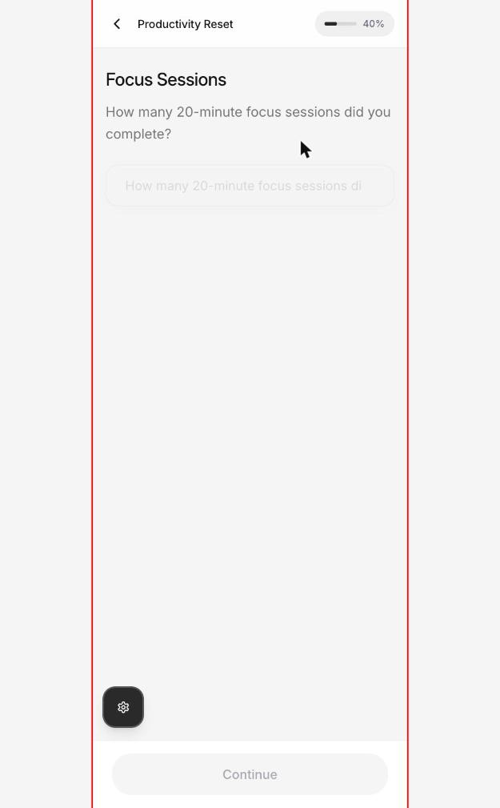
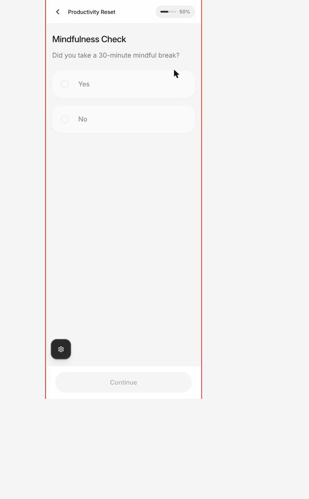
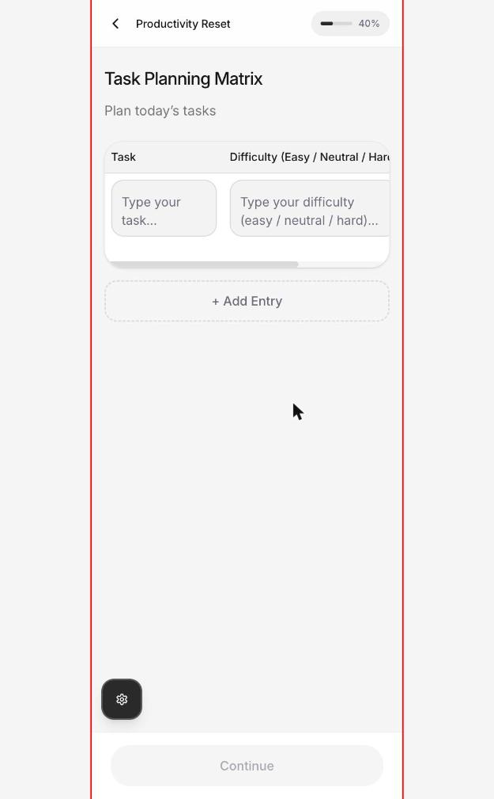
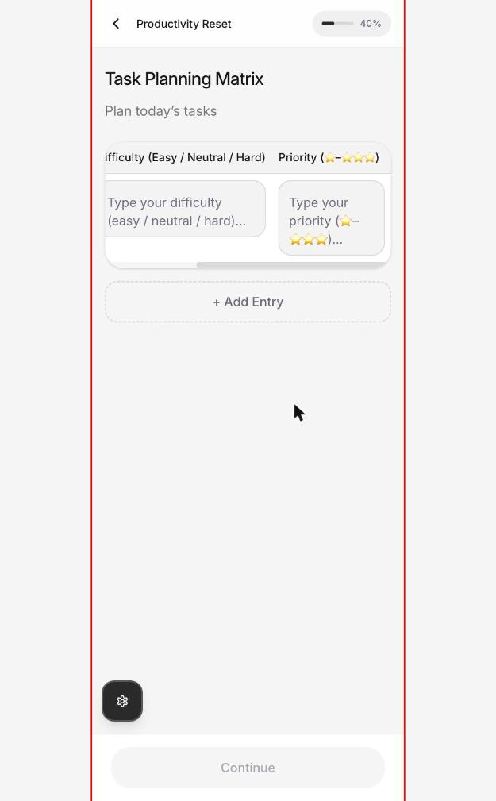
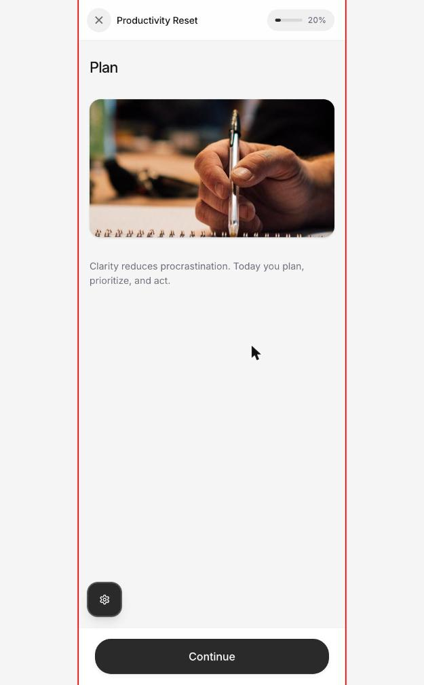
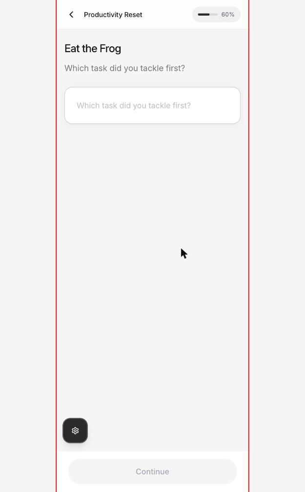
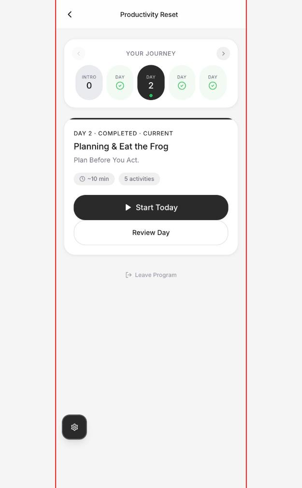
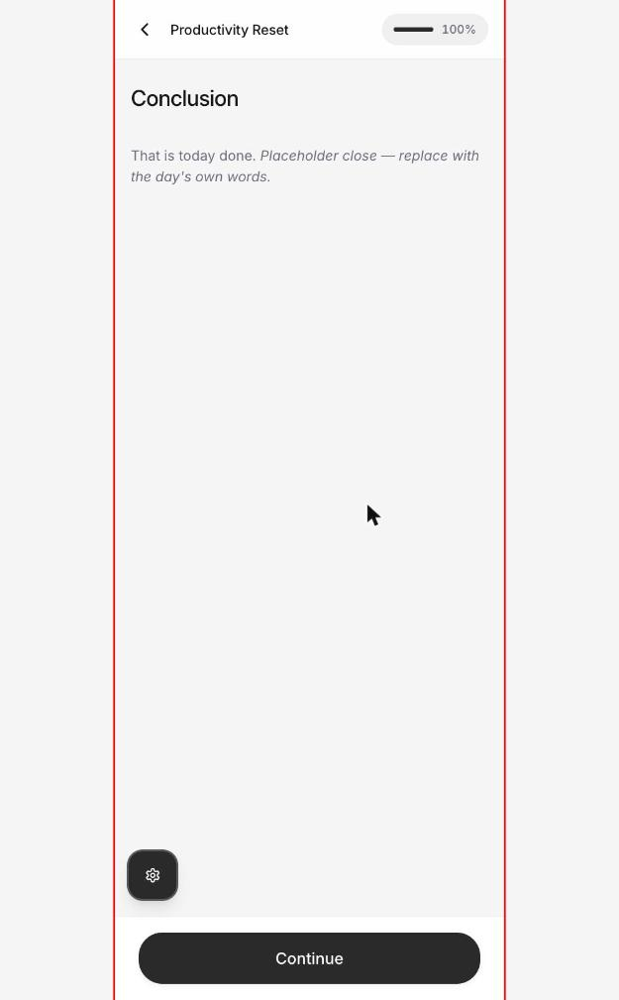

# iKan — Program Block Rendering Audit (mobile)

**Date:** 2026-09-09 · **Surface:** production, post-auth, as Wugweb Admin
**Routes:** `/dashboard`, `/equip-program-flow?id=33eae2e2-e0e5-4e09-a423-5d450607bb75` (Productivity Reset, days 2–4)
**Excluded on instruction:** the marketing site at `ikanhealth.in/`

---

## Method, and its limits

Chrome on macOS will not size a window below 625 CSS px. So the viewport was held at 625 — below the Tailwind `sm` breakpoint of 640, so every phone media query matches — and `#root` was clamped to 393px with `transform: translateZ(0)` so the flow's `position: fixed` layers resolve against that box instead of the window. The red hairline in every screenshot is the 393px frame.

Every pixel figure below is measured at that frame. Two things this does **not** reproduce:

- `100vw` values, which still resolve against 625
- real touch input, and the installed-PWA shell on a physical Nothing 3a / Mi

Everything else is faithful.

**Side effect you should know about:** re-running days 2 and 3 wrote the word `Audit` into three response fields on days already marked complete.

---

## P0 — blocks the user

### 1. Review Day is an unescapable dead end

On a completed day the block's input renders `disabled` + `pointer-events: none` + `opacity: 0.5`, and **Continue is `disabled: true` because that same input has no value.** There is no third control. The back chevron is the only way out.

Measured on two independent block types:

| Day | Block | Control | Measured state |
| --- | --- | --- | --- |
| 3 | Focus Sessions | `input[type=number]` | `disabled: true`, `pointerEvents: none`, `opacity: 0.5` |
| 4 | Mindfulness Check | `button[role=radio]` × 2 | `disabled: true`, `tabIndex: -1`, `opacity: 0.5` |

Full button inventory on screen in both cases: back (no accessible name), Continue (`disabled: true`), admin FAB. Nothing else.

Every completed day whose second block requires an answer is a trap.




### 2. Review Day *is* Start Today

Day 2 opens at 20%, block 1 of 5, empty fields — identical from both CTAs. No saved responses load on any block. On days 3 and 4, "Review Day" is the **only** CTA, and it starts an editable run.

### 3. No service worker — the PWA is not a PWA

`navigator.serviceWorker.getRegistrations()` returns **0**.

`manifest.json` declares `display: standalone`, `orientation: portrait-primary`, 4 icons including a maskable 512. `pwa-64x64.png` is fetched. `localStorage` holds `ikan-offline-mode: "false"`. The scaffolding is all there; the runtime is not.

Consequences, matching the Nothing 3a / Mi report exactly: no offline, no cache, and Android Chrome will not offer install without a fetch-handling SW.

Separately: `start_url` is `"/"`, so an installed app opens on the marketing page.

### 4. Route hijack into the program flow

While a day session was in flight, `/dashboard` rendered for ≈6s and then force-navigated to `/equip-program-flow?id=…`. Reproduced on 3 consecutive hard reloads with a 1s location poll:

```
248ms   /dashboard
...
5255ms  /dashboard
6256ms  /equip-program-flow?id=33eae2e2-e0e5-4e09-a423-5d450607bb75
```

Also reproduced from `/assessment`. `/mood-journal`, `/resource` and `/equip` were unaffected. The hijack stopped once the day session resolved to the day-overview screen.

So it is state-dependent, not universal — but while it holds, the account cannot reach its own dashboard.

### 5. Table blocks overflow on every phone

The table block renders a real `<table>` (`display: table`, intrinsic width **529px**) inside a **360px** scroll container.

```
clientWidth: 360 · scrollWidth: 529 · hidden: 169px (32%)
```

At 393px, a third of the table is off-screen, discoverable only via a thin `overflow-x` scrollbar. Column 2's header truncates mid-word: `Difficulty (Easy / Neutral / Har…`.



Scroll it right and the hidden column appears — and the first column disappears. You can never see all three at once.



The hidden column is `Priority (⭐–⭐⭐⭐⭐)` — **a star rating collected as free text, with emoji in the placeholder.** Same for column 2: `easy / neutral / hard` is a 3-option choice rendered as a text field.

The Motivation Table you screenshotted has 4 columns. Same component, worse ratio.

---

## Agenda 1 — standardise the rendered program UI

### Measured type scale (identical across all blocks, days 2–4)

| Role | Element | Size | Weight | Line-height |
| --- | --- | --- | --- | --- |
| App-bar title | `h1` | 14px | 500 | 21px |
| Progress % | `span` | 12px | 500 | 18px |
| Block title | `h2` | 22px | 500 | 30.25px |
| Block subtitle | `p` | 17px | 400 | 27.625px |
| Block body copy | `p` | 14px | 400 | 21px |

Three problems:

1. **The `h1` is 14px and the `h2` is 22px.** The document's only `h1` is the app-bar chrome label; the actual page title is an `h2`. Heading order is inverted, and there is no `h3` anywhere in the flow.
2. **Two `p` scales, 17px and 14px, with no rule.** "Plan today's tasks" (subtitle) is 17px; "Clarity reduces procrastination…" (body) is 14px. Adjacent roles, arbitrary split.
3. **Line-heights of 30.25px and 27.625px.** Unrounded values are not coming from a token scale — they are `leading-*` multipliers landing wherever they land.

### Input UI is not one system

| Block | Control | Height | Note |
| --- | --- | --- | --- |
| Task Planning Matrix | `textarea` × 3 in `<table>` | ~60px | inside horizontal scroller |
| Eat the Frog | `textarea` | ~80px | |
| Reflection | `textarea` | ~80px | identical to above |
| Focus Sessions | `input[type=number]` | 52px | |
| Mindfulness Check | `button[role=radio]` 20×20 + `label` 361×69 | 69px row | label not associated |
| + Add Entry | dashed-border button | 48px | style appears nowhere else |

Five different field shells for what is functionally text / number / choice.

### Chrome inconsistencies

- Header icon button is **40×40** on flow screens and **36×36** on the Review-Day entry. Same control, two sizes.
- Header icon is `✕` on block 1 and `‹` on blocks 2+. Same position, two meanings, no accessible name on either.
- Both header button and Continue are `type="submit"`.
- Progress denominator changes per day (20% steps on 5-activity days, 25% on 4-activity days) with no total shown.

### Dead space

At 393 × 852, every block leaves roughly `400 ≤ empty_px < 700` between the end of content and the pinned Continue bar. On Reflection, content ends at y ≈ 260 and Continue sits at y ≈ 878 — about 70% of the screen empty.



---

## Agenda 2 — responsive columns, diary, tracker

The table block is the whole problem, and it is one component reused for every columnar block (planning matrix, motivation table, and by component identity the sleep diary / tracker family).

**What it does now:** `<table>` → natural column widths → intrinsic width exceeds viewport → parent `overflow-x: auto`.

**What it needs below 640px:** collapse to stacked record cards. One card per row; each field a labelled, full-width control. `Task` / `Roadblock` / `Reward` / `Urgency` become four labelled fields in a card, not four columns in a 529px table. Horizontal scrolling for *data entry* on a phone is not a fallback, it is a defect.

Secondary, same block:

- `Difficulty` (easy / neutral / hard) and `Priority` (⭐–⭐⭐⭐⭐) are structured choices rendered as free text. Segmented control and star input respectively.
- Validation passes with 1 of 3 columns filled — Continue enabled after a single field. Either the others are optional (say so) or validation is wrong.
- Header labels are the only labels. Once a field has content and the header has scrolled off, the user cannot tell what they are typing into.

---

## Agenda 3 — recycle components

Evidence the blocks are hand-assembled rather than composed:

- **Eat the Frog** and **Reflection** are the same long-text block rendered twice, back to back, each carrying its own duplicated subtitle and placeholder.
- On three blocks the subtitle and the placeholder are **byte-identical** — "Which task did you tackle first?", "How did it feel after completing it?", "How many 20-minute focus sessions did you complete?" — printed twice on screen, with the placeholder then truncating (`How many 20-minute focus sessions di`).
- `+ Add Entry` uses a dashed-outline style found nowhere else in the app.
- The header icon button ships at two sizes with two icons.



**Target:** one `BlockShell` (title / subtitle / media / body / footer CTA — one type scale, one spacing scale) plus one `Field` primitive per interaction — text, long text, number, single choice, multi choice, table-as-cards — and every activity composes from those.

Per the settled model, `interaction = f(activity)`. The renderer should follow the same rule rather than each block owning its own markup.

---

## Accessibility — WCAG 2.1 AA

**Surface:** `/equip-program-flow` at 393px · **Issues:** 9 · **Critical:** 4 · **Major:** 5

| # | Issue | Criterion | Severity | Fix |
| --- | --- | --- | --- | --- |
| 1 | Choice options: both the `button[role=radio]` and its `label` carry `tabIndex: -1`. Options are not keyboard reachable at all. | 2.1.1 Keyboard | Critical | Radios in the tab/arrow order; roving tabindex within the `radiogroup` |
| 2 | Radios have no accessible name — no text content, `aria-label` null, label not associated. Screen reader announces "radio, not checked" with no option name. | 4.1.2 Name, Role, Value | Critical | `aria-labelledby` to the label, or move label text inside the control |
| 3 | Every `textarea` and `input` returns `hasLabel: false`. Placeholder is the only cue and it disappears on input. | 3.3.2 Labels or Instructions | Critical | Persistent visible `<label for>` on every field |
| 4 | Header back/close button has no accessible name and `type="submit"`. It is the only navigation control on the screen. | 4.1.2 | Critical | `aria-label`, and `type="button"` |
| 5 | Radio hit target 20×20. | 2.5.5 Target Size | Major | ≥ 44×44, or make the 361×69 label the control |
| 6 | Header icon button 40×40 (36×36 elsewhere); skip link 40px high. | 2.5.5 | Major | ≥ 44×44 |
| 7 | `h1` is 14px chrome; page title is `h2`; no `h3`. Heading order inverted. | 1.3.1 Info and Relationships | Major | Block title becomes the `h1` of the flow view |
| 8 | Continue is `disabled` with no message stating what is required. In review mode it can never be enabled. | 3.3.1 Error Identification | Major | Enabled-with-message pattern, or enable Continue in review mode |
| 9 | Table content extends 169px beyond the viewport with no non-scroll route to it. | 1.4.10 Reflow | Major | Card layout below 640px |

---

## State and data integrity

| # | Observed | Expected |
| --- | --- | --- |
| 1 | Day 2 header reads `DAY 2 · COMPLETED · CURRENT` | One status |
| 2 | Days 3 and 4 render `COMPLETED` while `currentDay` is 2 | Future days not complete |
| 3 | `enrollment.progress` is `[]` while `currentDay` is 2 | Progress recorded |
| 4 | Dashboard says "Day 1 of 9", enrollment says `currentDay: 2`, program screen says Day 2 | One answer |
| 5 | Journey rail shows a number only on the selected chip and INTRO; all others render "DAY" + a checkmark | Day numbers always visible |
| 6 | `startDate` 2026-03-13, still Day 2 on 2026-09-09; dashboard lists it under "Latest Activity · Mar 13" | Stale enrollment surfaced honestly |



---

## Performance and storage

### localStorage is over 1.1 MB on one account

| Key | Size (chars) |
| --- | --- |
| `ikan-ocache-equip-programs` | 595,383 |
| `dashboard_data_<uid>` | 182,178 |
| `ikan_equip_draft_<id>` | 152,958 |
| `ikan-ocache-assessments-list` | 140,560 |

The origin cap is ~5 MB, and this is **one** enrolled program plus a handful of assessments.

- `ikan_equip_draft_…` is an **admin authoring draft persisted in the member app** and never cleaned up.
- `dashboard_data_<uid>` and `ikan-ocache-user-enrollments` both store enrollments — two sources of truth.
- `ikan_remembered_email` and `ikan_admin_remembered_email` duplicate each other.

Every read of the 580KB program cache is a synchronous `JSON.parse` on the main thread. On a Nothing 3a that is the jank.

### The app bootstraps twice per load

Console prints each of these **twice**, 12s apart: `Creating new Supabase client instance`, `Initializing authentication`, profile fetch, recommendation-engine init, and `[Dashboard] Assessment history: found 39 completed responses, 7 display scores`.

`[HealthBridge] Initialized v1.0.0` printed 10+ times in one session.

### Duplicate API calls in a single dashboard load (153 resources total)

| Endpoint | Calls |
| --- | --- |
| `health-connect/status` | 5 |
| `health-connect/data` | 5 |
| `user/journal` | 4 |
| `user/enrollments` | 4 |
| `assessments` | 3 |
| `users/profile` | 3 |
| `library/resources` | 3 |

### Latency

Every edge-function call falls in `800 ≤ ms ≤ 2150`. Slowest: `admin/users/<id>` at 2147ms — an **admin endpoint called from the member dashboard**.

Dashboard content appeared ~12s after navigation. Document TTFB was 61ms and `loadEventEnd` 599ms, so this is entirely the API layer plus the double bootstrap.

---

## Content defects — Kartik's call, not changed here

1. **Placeholder copy is live in production.** Day 2, block 5 (Conclusion): *"That is today done. Placeholder close — replace with the day's own words."*

   

2. Subtitle and placeholder are byte-identical on Eat the Frog, Reflection and Focus Sessions.

3. Equip landing duration mismatches: **Unburn** badge "31 days" vs copy "A comprehensive 30-day program"; **Stress Buster** badge "28 days" vs copy "A 30-day guided program". The Unburn admin draft in localStorage carries `duration_days: 35` — a third number.

---

## Change brief for Claude Code

Ordered. 1–3 are shipping blockers.

1. **Unblock review mode.** When a day is complete, either render a genuine read-only summary of saved responses, or keep inputs disabled and make Continue advance unconditionally. Never both disabled. Add a regression test: for every block type, `reviewMode === true` implies at least one enabled forward control.
2. **Load saved responses into review mode.** Read by `activityConfig.key` with the block-id fallback, per the settled response-identity rule.
3. **Register the service worker.** Wire the existing PWA scaffolding, set `start_url` to `/dashboard`, verify the Android install prompt on a real device.
4. **Table block → card layout below 640px.** One card per row, each field labelled and full width. Delete the horizontal scroller on mobile. Replace the `Difficulty` and `Priority` text columns with a segmented control and a star input.
5. **One `BlockShell` + one `Field` primitive set.** Fix the type scale to tokens; block title becomes the `h1`; kill the 17px/14px split; one icon-button size at 44×44 with an `aria-label`.
6. **Field accessibility pass.** Visible `<label for>` everywhere; `aria-labelledby` on radios; radios in the keyboard order; `type="button"` on nav controls.
7. **Find the `/dashboard` → `/equip-program-flow` redirect** and gate it on an explicit user action. Reproduce by leaving a day session mid-block and hard-reloading `/dashboard`.
8. **Kill the double bootstrap**, then dedupe the repeated fetches behind a request cache.
9. **Cap the local cache.** Stop persisting full program payloads; evict `ikan_equip_draft_*` from the member app; collapse `dashboard_data_<uid>` and `ikan-ocache-user-enrollments` to one source.
10. **Reconcile day state.** One status per day; no completed days ahead of `currentDay`; one "Day N of M" answer across dashboard / enrollment / program screen.
11. **Move `admin/users/<id>` off the member dashboard.**

---

## Not covered

- **Sleep diary and tracker blocks** — not reachable without enrolling in Sleep Tight, which would mutate live enrollment state. The table findings apply by component identity, not by direct measurement. Say the word and I will enrol and measure.
- Real touch behaviour and the installed-PWA shell on a physical Nothing 3a / Mi.
- Block types beyond the 6 encountered in Productivity Reset days 2–4. The settled model has 17 block types → 20 activities → 17 interactions; this audit saw content, table, long-text, short-number and single-choice.
- Code review of the repo — Claude Code owns that surface.

---

## Screenshot index

| File | Shows |
| --- | --- |
| `screens/01-day-overview-state-contradiction.jpg` | `DAY 2 · COMPLETED · CURRENT`; journey rail with unnumbered days |
| `screens/02-block-plan-deadspace.jpg` | Content block; ~480px empty above the Continue bar |
| `screens/03-table-block-clipped.jpg` | Task Planning Matrix; column 2 header truncated mid-word |
| `screens/04-table-block-hidden-column.jpg` | Same table scrolled right; `Priority (⭐–⭐⭐⭐⭐)` as free text; column 1 now gone |
| `screens/05-longtext-duplicate-copy.jpg` | Subtitle and placeholder byte-identical |
| `screens/06-conclusion-placeholder-live.jpg` | Placeholder copy shipped to production |
| `screens/07-deadend-number-input.jpg` | Review mode: input disabled, Continue disabled |
| `screens/08-deadend-choice-block.jpg` | Review mode: radios disabled, Continue disabled |

Notion: [iKan — Program Block Rendering Audit (mobile, 2026-09-09)](https://app.notion.com/p/3d6bb710b9ab8102a28dcac4c453c205)
