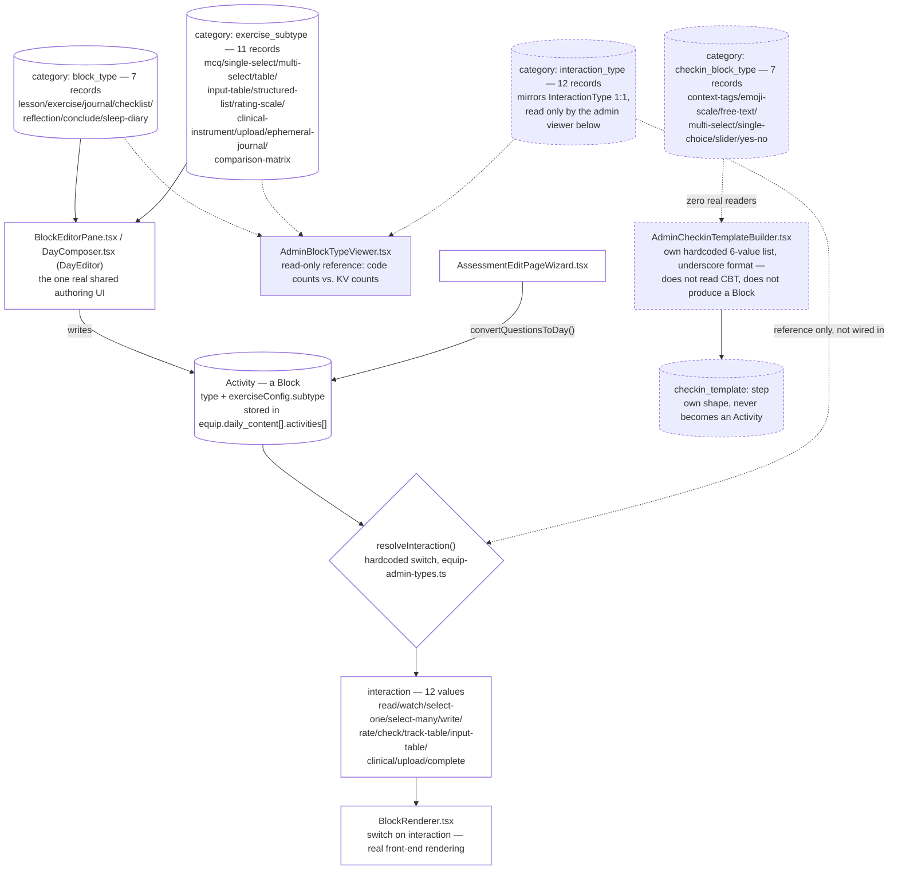

# Block

Pulled live from Supabase project `jpfvoevxegnknxoqmwye` on 2026-08-06. Answers the question this
session's Builder conversation converged on: what actually *is* a Block, how big is its schema, and
does front-end rendering belong to it (yes — see the three-tier model below). One real correction
made to an earlier doc while writing this (§04's `checkInConfig`/`scale_key` claim, wrong — see
`mood-checkin.md`).

## The model: Builder → Block → offerings

A Block is the one content/interaction primitive Equip and Assessment already share
(`builder-editor-architecture.md`, §11). This doc treats it as first-class, because in code it
already is one — `Activity` (the actual TypeScript name; "Block" is what this session calls it,
matching the admin UI's own language) has a schema as large as the Metadata Catalog's, spread
across three tiers that resolve into each other:

| Tier | What it answers | Where it lives | Backed by KV? |
|---|---|---|---|
| **1. Type** | What *kind* of content is this? (`lesson`, `exercise`, `journal`, …) | `Activity.type`, 7 values | Yes — `block_type` (7 records), **real consumer**: `builder/editor/BlockEditorPane.tsx` (was `EquipBlockEditor.tsx`/`EquipDailyEditor.tsx`) |
| **1b. Subtype** | Within `exercise`, what shape of interaction? (`mcq`, `rating-scale`, …) | `Activity.exerciseConfig.subtype`, 12 values | Yes — `exercise_subtype` (11 records), **real consumer**: `BlockEditorPane.tsx`, `BlockFieldSections.tsx`, `builder/content/ContentScreen.tsx` (was `EquipBlockEditor.tsx`) |
| **2. Interaction** | Collapsing type+subtype into "how does a user answer this" | `resolveInteraction()` in `equip-admin-types.ts`, 12 values | Yes, but **decorative** — `interaction_type` (12 records) is read by exactly one screen (`AdminBlockTypeViewer.tsx`, a read-only reference/count comparison), never by the resolver itself, which is a hardcoded `switch` |
| **3. Render** | What React component actually draws it | `BlockRenderer.tsx`, `switch` on the 12 `InteractionType` cases | No — pure code, dispatches on tier 2's output |

**Front-end rendering is tier 3 of Block's own schema, not a separate concern** — this closes the
open question from the Builder conversation. A Block's `type`/`subtype` (tiers 1/1b, authored)
resolve through `resolveInteraction()` into an `interaction` (tier 2, the unified answer-shape),
which `BlockRenderer.tsx` then dispatches on directly (tier 3). Nothing renders off `type` or
`subtype` directly — everything goes through the interaction tier.



## Full block-flavor inventory (live, 2026-08-06)

Every "how does a user answer this" concept that exists in this codebase today, wherever it's
implemented:

| Flavor | Lives as | KV backing | Real reader? | Renders via |
|---|---|---|---|---|
| Lesson / read | `type: lesson` | `block_type` | ✅ Editor | `interaction: read` → `BlockRenderer` |
| Exercise (all subtypes) | `type: exercise` + `exerciseConfig.subtype` | `block_type` + `exercise_subtype` | ✅ Editor | subtype → interaction → `BlockRenderer` |
| Journal / write | `type: journal` | `block_type` | ✅ Editor | `interaction: write` → `BlockRenderer` |
| Checklist | `type: checklist` | `block_type` | ✅ Editor | `interaction: check` → `BlockRenderer` |
| Reflection | `type: reflection` | `block_type` | ✅ Editor | `interaction: write` (or `select-one` if options present) |
| Conclude | `type: conclude` | `block_type` | ✅ Editor | `interaction: complete` → `BlockRenderer` |
| Sleep diary | `type: sleep-diary` | `block_type` | ✅ Editor | `interaction: track-table` → `BlockRenderer` |
| Check-in: emoji scale | `AdminCheckinTemplateBuilder`'s `emoji_scale` | `checkin_block_type: emoji-scale` (unread) | ❌ hardcoded only | `MoodJournal.tsx`'s own step renderer — **not** `BlockRenderer` |
| Check-in: free text | `free_text` | `checkin_block_type: free-text` (unread) | ❌ hardcoded only | same, own renderer |
| Check-in: multi select | `multi_select` | `checkin_block_type: multi-select` (unread) | ❌ hardcoded only | same |
| Check-in: single choice | `single_choice` | `checkin_block_type: single-choice` (unread) | ❌ hardcoded only | same |
| Check-in: slider | `slider` | `checkin_block_type: slider` (unread) | ❌ hardcoded only | same |
| Check-in: yes/no | `yes_no` | `checkin_block_type: yes-no` (unread) | ❌ hardcoded only | same |
| Check-in: context tags | handled as a special case, not in `BLOCK_TYPES` | `checkin_block_type: context-tags` (unread) | ❌ hardcoded only | same |

**None of Check-in's 7 flavors are Blocks today** — they're a parallel, same-shaped concept
rendered by `MoodJournal.tsx`'s own step logic, never touching `Activity`/`BlockRenderer`. This is
the concrete meaning of "Check-in Builder becomes a Block": collapsing this whole left-hand column
into the existing `type`/`exerciseConfig.subtype` tiers (already proven to cover 4 of 6 non-tag
cases 1:1 in `builder-editor-architecture.md`'s mapping table) so Check-in steps are `Activity`
records like everything else, and Scales stop being Check-in-exclusive — usable from an Equip day
or an Assessment question exactly the same way.

## Full `Activity` (Block) field schema — every field, not just type/subtype

The three-tier model above covers *what kind* of block something is. A Block also carries a set of
cross-cutting features independent of type — these apply to any block, and are as much "the Block
schema" as type/subtype/interaction. Read directly from the `Activity` interface
(`equip-admin-types.ts:184-202`) plus its two feature-specific interfaces:

| Field | Type | What it does |
|---|---|---|
| `id` | string | Stable identity — critical for carry-forward (see below), since `progress.block_responses` is keyed by block id |
| `title` / `subtitle` | string | Display text |
| `type` / `interaction` | tiers 1/2 above | — |
| `content` | string (rich text) | Lesson/journal/reflection/conclude body copy |
| `duration` | number (minutes) | Estimated time, shown in the player |
| `required` | boolean | Blocks day completion if unanswered |
| `order` | number | Position within the day |
| `exerciseConfig` | `ExerciseConfig` | Subtype-specific config (tier 1b) |
| `image_url` | string | Image or video (YouTube/Vimeo/`.mp4`) attachment |
| `data_id` | string | Optional external data reference |
| **`stepGroup`** | string | **Wizard-flow grouping** — blocks sharing a `stepGroup` id render together as one navigable step. Governed per-day by the preset's `stepGroupRules` (`allowed`/`required`/`maxBlocksPerStep`/`oneBlockPerStep`/`oneStepPerLesson` — see the preset table below); enforcement here is real (`builder/editor/BlockFlowFooter.tsx` — was `EquipBlockEditor.tsx`'s wizard-flow UI — reads the day's `stepGroupRules.allowed`/`required` to gate the step field) |
| **`autoAdvance`** | boolean | Whether completing this block auto-advances to the next, vs. requiring an explicit tap — also preset-governed (`autoConfig.autoAdvance`) |
| **`repeat`** | `ActivityRepeat` | **Carry-forward / repetition** — see below |

### Carry-forward (`repeat`) — a block appearing on more than one day without duplicating data

`ActivityRepeat` (`equip-admin-types.ts:167-182`) lets a single block (one stable `id`) surface on
multiple days instead of being copy-pasted into each — copy-pasting would create new ids and
fragment `progress.block_responses`, since that's keyed by block id. Three modes:

| Mode | Behavior |
|---|---|
| `simple_repeat` | Prior days' entries shown read-only + one new entry per occurrence — e.g. a running mood log |
| `column_addition` | Prior columns stay read-only; new columns are introduced on specific days (`columnsByDay`) — e.g. a habit tracker growing week over week |
| `on_demand` | Reachable any day from `onDemandFromDay` onward — a single evolving response, not a new entry per day |

Plus `everyDay` (appear on every day after the block's home day) and `onDays` (explicit extra target
days). `repeatTargetDays()` (`equip-admin-types.ts:206-218`) resolves the actual day list at
runtime. This is real, live, and used in the block editor's "Carry forward" section (`builder/editor/BlockFlowFooter.tsx`, summarised on `builder/content/BlockRow.tsx`; was `EquipBlockEditor.tsx`) — not a
half-built feature like several of the vocabulary items above.

### Milestone feedback — `checkInConfig` / `ProgramCheckIn.tsx` (already documented as an outlier)

Not a Block feature — flagging here because it's the "pop up for feedback" surface adjacent to a
program's block flow. `equip.checkInConfig` (`enabled`/`triggerDays`/`triggerOnLastDay`/
`customTitle`) triggers `ProgramCheckIn.tsx` on milestone days (7/14/30 or the last day) — 4
hardcoded questions, no Block/KV involvement, already covered in full under "Issues found" below and
in `mood-checkin.md`'s correction. Restated here only so this doc's inventory of "everything
block-adjacent" is complete in one place, per this turn's "remember all of it" instruction.

## Full block-type × subtype inventory — use case, behavior, taxonomy, interaction (2026-08-06)

Every `block_type` and `exercise_subtype` value, one row each (18 rows — the 7-row table above
collapses `exercise`'s 11 subtypes into one line; this doesn't), with the concrete default behavior
each one actually ships with (pulled from `day-presets.ts`'s `defaultBlocks`, not assumed):

| Value | Tier | Use case | Default behavior | Interaction (tier 2) |
|---|---|---|---|---|
| `lesson` | type | Read educational/instructional content | `autoAdvance:false` — user reads at their own pace | `read` |
| `exercise` | type | Container for any scored or unscored interactive question — see subtypes below | Varies entirely by subtype | Varies by subtype |
| `journal` | type | Free-text entry, often ephemeral | `required` varies; frequently paired with `ephemeral-journal` subtype | `write` |
| `checklist` | type | Toggle a list of items | Commonly paired with `structured-list` subtype | `check` |
| `reflection` | type | Closure/sense-making prompt | `autoAdvance:false`; may carry options → becomes `select-one` | `write` (or `select-one` if options set) |
| `conclude` | type | Day-ending summary/CTA | `autoAdvance:false` — always the last block on a day | `complete` |
| `sleep-diary` | type | Specialized nightly tracker grid | Paired with `track-table`-shaped rendering | `track-table` |
| `mcq` | subtype | Single-answer scored question | `scoring:{enabled:true}` in Assessment/Quiz presets | `select-one` |
| `single-select` | subtype | Pick one, unscored | No scoring by default | `select-one` |
| `multi-select` | subtype | Pick several | Used by Check-in's own `multi_select` equivalent too (not yet unified — see Issues) | `select-many` |
| `table` | subtype | Yes/No grid | Blocked in Assessment/Quiz/Check-in presets (`blockedComponents`) | `track-table` |
| `input-table` | subtype | Free data-entry grid | Blocked in Assessment/Quiz/Check-in/Rest presets | `input-table` |
| `structured-list` | subtype | Ordered list with per-item input | Default for Tracker's checklist block | `check` |
| `rating-scale` (KV) / `rating_scale` (code) | subtype | Numeric scale, `slider_min`/`slider_max`/`slider_labels` | Used by Assessment-Lite, Tracker, Reflection, and Check-in's day preset defaults | `rate` |
| `clinical-instrument` (KV) / `clinical_instrument` (code) | subtype | Validated multi-question scored instrument (GAD-7/PHQ-9 shape) | Carries `questions[]` + `scale[]` | `clinical` |
| `upload` | subtype | File upload, configurable accepted types/max size | Not used in any of the 10 day-presets' `defaultBlocks` today — available, unauthored | `upload` |
| `ephemeral-journal` | subtype | Session-scoped journal, not long-term persisted | Default for Practice's journal block | `write` (or `select-one` if options set — a documented data inconsistency) |
| `comparison-matrix` (KV) / `comparison_matrix` (code) | subtype | Side-by-side comparison table | Allowed only in Workshop's preset | `input-table` |
| `likert` | subtype (code alias) | Alternate name for `rating_scale`, rendered identically | Not in the editor dropdown — alias only, per `AdminBlockTypeViewer.tsx`'s own note | `rate` |

## Presets with rules defined — all 10, from `day-presets.ts` directly

Every equip day carries a `dayType`, which resolves to a preset controlling what blocks are
allowed/blocked and how the player behaves. Read directly from `DAY_TYPE_PRESETS`
(`day-presets.ts:27-326`) — not summarized, not the 7-value list a stale TS union elsewhere implies:

| Preset | Description | `autoConfig` | `stepGroupRules` | Warnings/errors |
|---|---|---|---|---|
| `assessment` | Baseline measurement, severity scoring, recommendations | autoAdvance, no back-nav, scoring on | Step groups disallowed, one block per step | "Assessments should be fast" |
| `assessment-lite` | Awareness/reflection, non-scored | autoAdvance, back-nav allowed, scoring off | Step groups allowed, max 2 blocks/step | — |
| `learning` | Concept introduction | No autoAdvance, back-nav allowed | Step groups required, one step per lesson | "Must include at least one interaction" |
| `practice` | Data capture, reflection, application | No autoAdvance, back-nav, save-on-exit | Step groups allowed, not required | "State whether responses are stored or private" |
| `workshop` | Multi-step thinking (ideation/evaluation) | No autoAdvance, back-nav | Step groups **required**, max 3 blocks/step | 3 hard `errors`: no StepGroups / >3 blocks per group / mixed-intent blocks in one group |
| `tracker` | Daily repetition, habits, streaks | No autoAdvance, save-on-toggle | Step groups disallowed | "Should stay identical across days" |
| `reflection` | Closure, sense-making, review | No autoAdvance, no back-nav | Step groups disallowed | — |
| `check-in` | Quick daily mood check, 1-3 questions, no scoring | autoAdvance, no back-nav, scoring off, save-on-exit | Step groups disallowed, one block per step | "Keep under 2 minutes" |
| `rest` | No active tasks, optional gentle prompt | No autoAdvance, no back-nav | Step groups disallowed | "Auto-completes — no user action needed" |
| `quiz` | Knowledge check with scoring | autoAdvance, no back-nav, scoring on | Step groups disallowed, one block per step | "Keep to 5-10 questions max" |

### 🔴 A 4th vocabulary, and enforcement that's silently half-wired

`allowedBlocks`/`blockedComponents` on every preset above use **yet another** string vocabulary —
`mcq_single`, `mcq_multi`, `boolean`, `short_text`, `long_text`, `table_input`, `rtf_list`,
`journal_short`, `table_review`, `callout`, `media`, `date_time` — none of which are `block_type` or
`exercise_subtype` KV values. `validateBlockForDayType()` (`day-presets.ts:332-379`) bridges the two
with hardcoded, partial string-matching (e.g. `subtype === 'mcq' → key = 'mcq_single'`), not a real
mapping table.

**Worse: the enforcement this vocabulary exists for is half-disabled, silently.** Reading the
function's control flow directly:
```
if (preset.blockedComponents.some(b => key.includes(b))) {
   return { allowed: false, reason: ... };   // ← this DOES fire
}
const isAllowed = preset.allowedBlocks.some(...);   // computed...
// if (!isAllowed) return { allowed: false, ... };  // ← commented out, never runs
return { allowed: true };                            // ← always wins regardless of isAllowed
```
`blockedComponents` is enforced. `allowedBlocks` is computed and then **thrown away** — the
allow-list has no effect at all today. An admin authoring a Workshop day, for example, can add any
block type not explicitly on `blockedComponents` (empty for Workshop) even though `allowedBlocks`
was clearly meant to restrict the palette to `lesson`/`mcq_multi`/`rtf_list`/`table_input`/
`comparison_matrix`. **This is a strong candidate for "why we get orphaned/mismatched KV content"**:
the guardrail exists, is well-designed, and simply doesn't run.

## Cross-system map — what feeds what, mapped to zero tolerance for orphaned/hardcoded content

Every vocabulary and engine touched this session, and which offering(s) it actually reaches. "Real"
means an authoring or rendering path reads it; "Decorative" means only `AdminBlockTypeViewer.tsx`'s
reference screen reads it; "Hardcoded, no override path" means content ships as code with no KV
record able to change it, ever, in production.

| Source | Feeds → | Reach | Status |
|---|---|---|---|
| `block_type` (KV, 7) | Equip's block-type picker | Equip, Assessment (via shared editor) | ✅ Real |
| `exercise_subtype` (KV, 11) | Equip's subtype picker | Equip, Assessment (via shared editor) | ✅ Real |
| `interaction_type` (KV, 12) | Nothing — mirrors `InteractionType` 1:1 | `AdminBlockTypeViewer.tsx` only | 🔴 Decorative |
| `checkin_block_type` (KV, 7) | Nothing — Check-in uses its own hardcoded 6-value list instead | Zero readers | 🔴 Decorative |
| `day_config_type` (KV, 11) | Nothing — code uses `day-presets.ts`'s own 10-preset table | `AdminBlockTypeViewer.tsx` only; 4 of 11 KV values map to no code path at all | 🔴 Decorative |
| `day-presets.ts`'s `allowedBlocks`/`blockedComponents` vocabulary | Preset enforcement | Equip day authoring | 🟡 Half-wired — see above |
| `scoring-profile:` (KV, 0 rows) | Per-assessment severity bands | Assessment, if ever authored | 🟡 Correctly wired, unused — see `scoring-engine.md` |
| `recommendation_rule:` (KV, 18 rows) | Per-category equip targeting | Assessment results (both frontend and backend engines) | ✅ Real — but only the `{assessment_category, min_severity, equip_id}` fields are ever populated |
| `DEFAULT_RECOMMENDATION_RULES`/`OVERLAP_MAP`/`ESCALATION_RULES` (code, `recommendation-engine.ts`) | Severity → message/primary/secondary content | Every assessment result screen | 🔴 **Hardcoded, no override path** — see `recommendation-frontend-vs-backend.md` |
| `assessment-section-presets.ts` (code) | Per-assessment severity bands | All 7 assessments | 🔴 **Hardcoded** — exists in code specifically because `scoring-profile:` (the KV-backed equivalent) has never been used |
| Check-in's own `BLOCK_TYPES` (code, `AdminCheckinTemplateBuilder.tsx`) | Check-in's step-type picker | Mood Journal's daily check-in only | 🔴 **Hardcoded**, disconnected from `block_type`/`exercise_subtype`/its own `checkin_block_type` KV mirror |
| `ProgramCheckIn.tsx`'s 4 questions (code) | Milestone check-in modal | Equip programs with `checkInConfig.enabled` | 🔴 **Hardcoded**, no admin authoring surface at all |

**Reading this table as "what serves Builder/Content/Equip/Assessment/Mood Journal today":** Equip
and Assessment are served by the one real, KV-backed, correctly-wired path (`block_type` +
`exercise_subtype` → shared editor → `resolveInteraction()` → `BlockRenderer`). Mood Journal's daily
check-in and the milestone check-in are each served by their own hardcoded, disconnected system —
neither reads Blocks, and one (`ProgramCheckIn.tsx`) has no admin surface whatsoever. The
Scoring/Rule engines exist and are correctly built, but every piece of *content* they were meant to
carry (severity messaging, per-assessment bands) still lives in code, because nothing has ever been
authored through them. **Five of the twelve rows above are hardcoded-with-no-override or decorative
— not a minor footnote, the majority of the "content" layer that isn't the block editor itself.**

## Issues found

### 🔴 Three of 21 Metadata Catalog types are decorative, not two — `interaction_type` reclassified

`metadata-catalog.md` previously listed `media_type` and `checkin_block_type` as the only two types
with zero real readers. Re-verified this session, cross-checking every consumer that actually
destructures each bucket from `useMetadata()`:

| Type | Real (non-viewer) consumer? |
|---|---|
| `block_type` | ✅ `BlockEditorPane.tsx` (was `EquipBlockEditor.tsx`/`EquipDailyEditor.tsx`) |
| `exercise_subtype` | ✅ `BlockEditorPane.tsx`, `BlockFieldSections.tsx`, `ContentScreen.tsx` (was `EquipBlockEditor.tsx`) |
| `interaction_type` | ❌ **only `AdminBlockTypeViewer.tsx`** — a read-only reference/count screen, not an authoring or rendering path. `resolveInteraction()`, the actual code that computes a Block's interaction, is a hardcoded `switch` and never reads this KV type at all. |
| `checkin_block_type` | ❌ same as before — zero readers anywhere |
| `day_config_type` | ❌ **only `AdminBlockTypeViewer.tsx`**, same pattern — see next finding |

`interaction_type`'s 12 KV records mirror `InteractionType` 1:1 by value — someone clearly intended
this to eventually drive `resolveInteraction()`, the same direction `AdminBlockTypeViewer.tsx`'s own
comment implies ("*These are structural — they drive editor UI behavior and rendering logic*"). It
doesn't yet. Not fixed here — same category as the `checkin_block_type` gap, a real feature not
finished, not a data bug.

### 🟡 `day_config_type` has 11 KV records; three code paths disagree on how many are real

`day_config_type` holds 11 values: `assessment`, `assessment-lite`, `check-in`, `learning`,
`onboarding`, `practice`, `quiz`, `reflection`, `rest`, `tracker`, `workshop`. Three different code
paths disagree:

- `DayContent.dayType`'s TypeScript union (`equip-admin-types.ts`) declares **7**: `assessment` /
  `assessment-lite` / `learning` / `practice` / `workshop` / `tracker` / `reflection`.
- `day-presets.ts`'s actual `DAY_TYPE_PRESETS` table (read directly, confirmed — see "Presets with
  rules defined" above) defines **10**: the same 7 plus `check-in`, `rest`, and `quiz`.
- The KV catalog has **11** — the same 10 as `day-presets.ts`, plus one (`onboarding`) that exists in
  no code path at all.

So the gap is narrower than first estimated: `day-presets.ts` already covers `check-in`/`rest`/
`quiz` (the TS union is just stale, not the presets), and only `onboarding` is genuinely
KV-only-with-no-code-path. This is read only by `AdminBlockTypeViewer.tsx` for a count comparison —
nothing authors a day's type from this KV list; not a data-loss bug (no day record references a
missing type), but the `DayContent.dayType` union should be updated to match the 10 real presets,
and the Metadata Catalog's `day_config_type` tab has exactly 1 option (`onboarding`) that silently
does nothing if picked.

### 🟡 Check-in's hardcoded type strings don't even match their own (unread) KV mirror

Beyond not being read, the two lists use different string formats: `AdminCheckinTemplateBuilder.tsx`
uses underscores (`emoji_scale`, `free_text`, `single_choice`, `yes_no`), `checkin_block_type`'s KV
slugs use hyphens (`emoji-scale`, `free-text`, `single-choice`, `yes-no`) — generated by the
Metadata Catalog's own `slugify()` from the same display labels. Wiring the two together needs a
value-format normalization pass, not just pointing one at the other.

### 🔴 `ProgramCheckIn.tsx` — a second, more disconnected "check-in", found while tracing this

Distinct from everything above: `equip.checkInConfig` (`enabled`/`triggerDays`/`triggerOnLastDay`/
`customTitle`) triggers `ProgramCheckIn.tsx`, a **milestone** check-in modal (program day 7/14/30 or
last day) — not the Mood Journal's *daily* check-in. It has 4 fully hardcoded questions
(`perceivedChange`/`confidenceLevel`/`continuationIntent`/`feedback`), no KV involvement, no Block
or Scale reuse, and no authoring surface — `CheckInResult`'s own type has a commented-out
`customQuestions // (future)` field that was never built. **An earlier version of this session's
artifact and `mood-checkin.md` wrongly claimed `checkInConfig` links to `checkin_template:` via a
`scale_key` field — it doesn't; that field only exists on `checkin_template:` steps.** Corrected in
`mood-checkin.md`. Not fixed here (a real feature gap, not a data bug) — flagging because it's a
third same-family, similarly-named system, exactly the kind of thing that gets conflated with the
other two without a careful trace.

### 🟢 What's already correct: `AdminBlockTypeViewer.tsx` is a real, existing audit tool

Worth naming as a positive finding, not just gaps: someone already built the comparison this doc is
formalizing — `AdminBlockTypeViewer.tsx` documents `CHECKIN_BLOCK_TYPES` and `EQUIP_BLOCK_TYPES`
side by side, a `LEGACY_MAPPING` table (type/subtype → interaction, matching `resolveInteraction()`
exactly), and live "code count / KV count" stats for interaction types, block types, and day
presets. It's a read-only reference screen, not wired into any authoring path — but it's accurate,
and it's the reason this doc's live counts could be cross-checked against a second, independent
source instead of only `useMetadata.ts`'s `TYPE_TO_BUCKET`.

## Relations, made solid

Block's own relation to the rest of the schema, cross-checked against `schema-relations.md`'s
`RELATIONS` registry: `Activity` records are **not** a top-level KV prefix — they live embedded
inside `equip:{id}.daily_content[].activities[]`, one JSON blob per equip. This means a Block
structurally **cannot** become an orphan the way `day:`/`block:` (the legacy, now-unused REST-API
records) can — there's no separate key for a stray reference to dangle. `RELATIONS` correctly has no
entry for Blocks: the existing `progress: → equip:` relation already covers everything a Block's
responses could orphan against, since `progress.block_responses` keys off `Activity.id` values that
only ever exist inside an `equip:` record's own blob. **Verified as correctly-exempt, not a registry
gap.**

## Where to actually look at this today

`AdminBlockTypeViewer.tsx` is real and already builds a version of the comparison this doc
formalizes — reachable at `/admin/block-type-viewer` directly (works on a fresh page load/bookmark)
or via Admin → Config → "Block Types" in the sidebar. The URL and the sidebar click don't currently
agree with each other (see `docs/PENDING.md` for the precise, not-yet-fixed cause) — until that's fixed,
bookmark the URL directly rather than relying on in-app navigation to reach it.

## Verification notes

1. `Activity`'s full field schema read from `equip-admin-types.ts` directly (`type`, `interaction`,
   `exerciseConfig`, `repeat`, etc.) — not inferred from the editor UI alone.
2. Every "real consumer?" claim above is a `grep` for the actual destructured bucket name
   (`blockTypes`, `exerciseSubtypes`, `interactionTypes`, `checkinBlockTypes`,  `dayConfigTypes`)
   across `src/components` and `src/lib`, not a guess from file/type names.
3. Live KV counts (`block_type: 7`, `exercise_subtype: 11`, `interaction_type: 12`,
   `checkin_block_type: 7`, `day_config_type: 11`) are a direct `GROUP BY value->>'type'` query
   against `category:` records, run the same session this doc was written.
4. The `checkInConfig`/`scale_key` correction was found by `grep`ing the whole repo for
   `scale_key` and confirming every hit is a `checkin_template:` step field — none on an equip
   record — then reading `ProgramCheckIn.tsx` directly to confirm what `checkInConfig` actually
   triggers instead.
