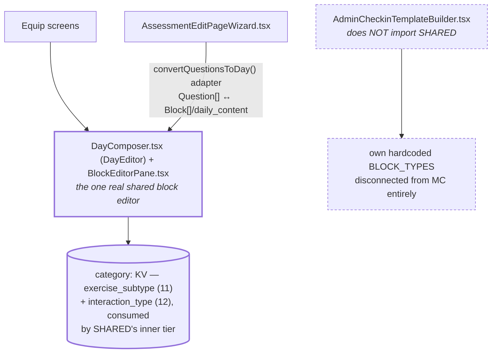

# Builder / Editor Architecture

Pulled live from Supabase project `jpfvoevxegnknxoqmwye` on 2026-08-06. **Correction to this doc's
first version, written the same day**: the first pass claimed three fully independent builders,
based on checking whether each wizard file calls `useMetadata()` directly for a type list. That
check missed whether one wizard *renders another's component* — it does. Re-verified by reading
the actual render tree, not just each file's own imports.

> **Renamed since this was written (2026-09-21 note).** `EquipDailyEditor.tsx` → `DayEditor.tsx`
> and `EquipBlockEditor.tsx` → `BlockEditor.tsx` (commit `0340aa21`, 2026-09-02); the builder was then
> rebuilt. Today the shared day editor is `src/admin/block-builder/DayComposer.tsx` (exports `DayEditor` — a
> thin adapter over `src/admin/block-builder/content/ContentScreen.tsx`), and per-block editing is
> `src/admin/block-builder/editor/BlockEditorPane.tsx` + `BlockFieldSections.tsx` + `BlockFlowFooter.tsx`.
> Names below are updated; the Verification notes keep the names that were grepped at the time.

## Corrected answer: 1 shared builder (correctly reused), 1 outlier

| Domain | What it actually renders | Type taxonomy |
|---|---|---|
| Equip | `DayComposer.tsx` (`DayEditor`) + `builder/editor/BlockEditorPane.tsx` | Native — this **is** the shared system |
| Assessment | **The same `DayEditor`**, imported directly (`import { DayEditor as DailyBuilder } from '../blocks/DayComposer'`, line 29 of `AssessmentEditPageWizard.tsx`) and rendered at line 968 | Same as Equip — a `convertQuestionsToDay()` adapter converts legacy `Question[]` to the shared `Block[]`/`daily_content` shape on load, and back on save |
| Check-in | `AdminCheckinTemplateBuilder.tsx` — does **not** import either Equip component | Its own hardcoded `BLOCK_TYPES` array, disconnected from everything else |

**So there aren't 3 independent systems — there's 1 real shared block editor, correctly reused by
2 of the 3 features, and 1 outlier that isn't using it.** Assessment reusing Equip's editor is the
system working as it should; Check-in not doing the same is the actual problem, and the honest
answer to "will a 4th feature invent a 4th builder" is: only if it doesn't follow the pattern
Assessment already demonstrates correctly.

## Builder includes rendering — confirmed, not assumed

Direct answer to "update Builder assuming frontend rendering is a part of it": **yes, confirmed by
reading the actual render code**, not just architectural inference. `src/product/app/features/player/`
(`ProgramPlayer.tsx` + `BlockRenderer.tsx`) is the third tier of the same pipeline the authoring
side (`DayEditor`/`BlockEditorPane`) writes into:

| Tier | Component | Role |
|---|---|---|
| Author | `DayComposer.tsx` (`DayEditor`) / `BlockEditorPane.tsx` + `BlockFieldSections.tsx` | Writes `Activity` records (Blocks) into `equip.daily_content[]` |
| Deliver | `ProgramPlayer.tsx` | Imported and rendered by every live flow that plays back a program: `EquipProgramWizard.tsx:774`, `EquipProgramFlow.tsx:580`, `EquipProgramOnboarding.tsx:337`, and — confirming Assessment really does share this pipeline end to end, not just at authoring time — `AssessmentFlow.tsx:596` |
| Render | `BlockRenderer.tsx` | Rendered by `ProgramPlayer.tsx` for every block; dispatches on `interaction` (§13's tier 2), the same value the authoring side resolves via `resolveInteraction()` |

**Audited for hardcoded/stale content, per the user's "if this is some previous hardcoded version —
fix it or remove it" standard**: confirmed clean. One version of each file, no dead alternate
renderer, no `v1`/`v2` split, no commented-out blocks. The only hardcoded content found
(`ProgramPlayer.tsx`'s `DAY_TYPE_CONFIG`, `BlockRenderer.tsx`'s default clinical-scale/rating labels)
is appropriately hardcoded UI/fallback logic — not admin content that should be KV-driven, and
always superseded by real `exerciseConfig` data when present. Nothing to fix here.

**So the full pipeline, stated plainly**: Author (`DayEditor`/`BlockEditorPane`) → Store
(`equip.daily_content[].activities[]`) → Deliver (`ProgramPlayer.tsx`) → Render (`BlockRenderer.tsx`,
dispatching on `interaction`). Builder isn't just the editing screen — it's this whole chain, and
Check-in is the one offering not connected to any tier of it (see the outlier framing below).

## What "mapping with block type" actually looks like — Check-in's types already have a home

The user's direct question: does Check-in's type set actually correspond to something in the
shared taxonomy, or is it a genuinely different concept? Checked side by side:

| Check-in's hardcoded type | What it does | Already exists in the shared taxonomy as |
|---|---|---|
| `single_choice` | pick one option | `exercise_subtype: mcq` / `interaction_type: select-one` (Assessment's default question type maps here) |
| `multi_select` | pick several | `exercise_subtype: multi-select` / `interaction_type: select-many` (Assessment's `'multiple-choice'` maps here) |
| `emoji_scale`, `slider` | rate on a scale | `exercise_subtype: rating-scale` / `interaction_type: rate` (Assessment's `'scale'` maps here) |
| `free_text` | open text answer | `exercise_subtype: ephemeral-journal` / `interaction_type: write` (Assessment's `'text'`/`'textarea'` maps here) |
| `yes_no` | binary choice | Not a distinct shared type today — but it's a `single_choice`/`mcq` with exactly 2 options, not a new interaction concept |
| `context_tags` | pick from a tag set | Genuinely Check-in-specific (backed by `checkin_scale:context_tags`, not an exercise concept) — the one real exception |

**4 of Check-in's 6 types are the same underlying concept as something Equip and Assessment
already share**, just named differently and formatted differently (underscore vs. the shared
system's mix of hyphens and `interaction_type` slugs). `yes_no` is a trivial special case of
`single_choice`. Only `context_tags` is a genuinely distinct concept, and even that already exists
as real, correctly-consumed data (`checkin_scale:context_tags`, confirmed clean in
`mood-checkin.md`) — it's just not expressed as an `exercise_subtype`/`interaction_type` because
those are equip/assessment-flavored names for the same idea.

**This is not a coincidence** — it's the same small set of "how does a user answer this" concepts
(pick one, pick many, rate, write freely, plus one tag-picker) showing up in all three domains,
implemented three times with three different string formats, only one of which was ever
consolidated. The Metadata Catalog's `checkin_block_type` type (§10, Bug 4 — 7/7 records, zero real
readers) exists as if someone started this consolidation and then the builder itself never got
switched over to read it.

## What would actually fix this (not done here — flagging, not changing a live admin screen unasked)

Point `AdminCheckinTemplateBuilder.tsx`'s step-type picker at `exercise_subtype`/`interaction_type`
(the taxonomy already proven to work for two of three domains) instead of its own hardcoded array,
the same way Assessment already correctly points at Equip's shared editor instead of building its
own. This would also make the currently-dead `checkin_block_type` Metadata Catalog type either
genuinely used or safely removable, closing §10's Bug 4 at the same time. Not implemented here —
this changes what a real, currently-shipped admin screen renders, which is a real feature change,
not a mapping exercise; flagging for a decision rather than doing it unasked.

## Restated, 2026-08-06: there is no "Check-in Builder" — Check-in should just be Blocks

Confirmed with the user, and consistent with the finding above: Check-in isn't a third kind of
builder that needs reconciling with the other two — it's the same content as Equip/Assessment
(something a user reads/answers/rates/writes), authored through a separate hardcoded type list for
no structural reason. Once `AdminCheckinTemplateBuilder.tsx` reads `exercise_subtype`/
`interaction_type` the way Assessment already does, "Check-in Builder" stops being a system and
becomes **a Block**, the same as any Equip day's content — with Check-in Scales (`checkin_scale:`)
as one interchangeable source of vocabulary a Block can render from, not a Check-in-exclusive
concept (a Scale is just as usable inside an Equip day or an Assessment question). See
`block-architecture.md` (§13) for the full schema this collapses into, and `mood-checkin.md` (§05)
for what this means for the Mood Journal specifically — it needs Scales + Blocks, not a dedicated
builder of its own.

**A second, previously undocumented outlier, found while re-verifying this:**
`ProgramCheckIn.tsx` (the *milestone* check-in modal — triggered on program days 7/14/30 or the
last day, distinct from the Mood Journal's *daily* check-in flow above) is more disconnected than
Check-in's builder ever was: 4 fully hardcoded questions (`perceivedChange`/`confidenceLevel`/
`continuationIntent`/`feedback`), zero KV involvement, zero Block/Scale reuse, and no admin
authoring surface at all — `CheckInConfig`'s own type definition has a commented-out
`customQuestions?: CheckInQuestion[] // (future)` field that was never built. This is not the same
system as `checkin_template:`/`AdminCheckinTemplateBuilder.tsx` despite the similar name — see
`block-architecture.md`'s issues section for detail. Not fixed here; noted because it's the kind of
thing that reappears every time someone reaches for "check-in" without checking which of the (now)
three same-named systems they mean.

## Verification notes

1. The corrected finding (Assessment reuses Equip's editor) was found by grepping
   `AssessmentEditPageWizard.tsx` for `EquipDailyEditor`/`EquipBlockEditor` imports (names at the time; now `DayEditor` from `DayComposer.tsx`) — a check the
   first pass of this doc skipped, checking only each file's own `useMetadata()` usage instead of
   its actual render tree. Corrected the same day it was found, per this session's standing
   practice of re-verifying rather than defending a first-pass finding.
2. Confirmed Check-in genuinely does not import either Equip component (`grep` returned nothing) —
   the "1 outlier" framing isn't assumed, it's the negative result of the same check that found
   Assessment's reuse.
3. The type-mapping table was built by reading `AssessmentEditPageWizard.tsx`'s
   `convertQuestionsToDay()` (lines 30-68, the legacy-type → subtype/interaction mapping) against
   `AdminCheckinTemplateBuilder.tsx`'s hardcoded `BLOCK_TYPES` and the live `exercise_subtype`/
   `interaction_type`/`checkin_block_type` Metadata Catalog content — not inferred from naming
   alone.
