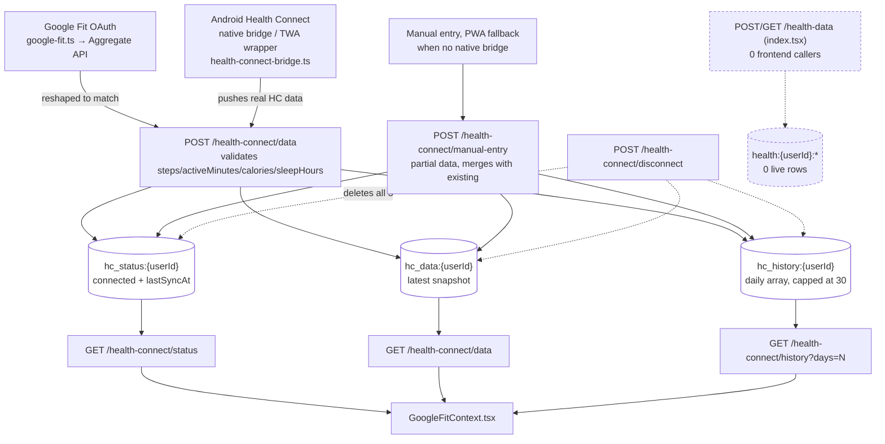

# Health Connect / Google Fit — 3rd-party IoT & health data

Pulled live from Supabase project `jpfvoevxegnknxoqmwye` and the repo, 2026-08-06.

## Status: correctly wired, zero data — like the Scoring Engine, never used yet

| Prefix | Live rows |
|---|---|
| `hc_status:{userId}` | 0 |
| `hc_data:{userId}` | 0 |
| `hc_history:{userId}` | 0 |
| `health:{userId}:*` (legacy, superseded) | 0 |

**No user has ever connected a fitness provider in production.** Not a bug — verified end-to-end,
not assumed dead.

## What it is

Steps/active-minutes/calories/sleep data from Android Health Connect (the on-device health data
API) or Google Fit, synced into the app for display and — architecturally, not yet wired — as a
future input to the iKan Wellness Score's Engagement component.

| Piece | Location |
|---|---|
| Backend | `src/supabase/functions/server/health-connect-routes.ts` (233 lines) |
| Endpoints | `GET/POST /health-connect/status`, `POST /health-connect/connect`, `POST /health-connect/disconnect`, `GET/POST /health-connect/data`, `GET /health-connect/history`, `POST /health-connect/manual-entry` — all `requireAuth` |
| Frontend context | `GoogleFitContext.tsx` (346 lines) — `useGoogleFit()`/fitness provider state |
| Google Fit client | `src/product/app/lib/google-fit.ts` — OAuth token → Google Fit Aggregate API → reshapes into the same payload `/health-connect/data` expects |
| Native bridge | `src/product/app/lib/health-connect-bridge.ts` — for an Android TWA/companion-app data push path (Health Connect has no REST API of its own; only an on-device SDK) |
| Legacy (superseded) | `/health-data` in `index.tsx` — explicitly commented `// Legacy — see health-connect-routes.ts for new endpoints`, writes `health:{userId}:{date}` + `health:{userId}:latest`. **Zero frontend callers** — confirmed dead, correctly self-labeled in the code, not a bug. |

## How it works — three ways data can arrive, one storage shape

## Data shape

`hc_data:{userId}` (and each `hc_history:{userId}` entry's `.data`) requires exactly 4 fields on
write — `steps`, `activeMinutes`, `calories`, `sleepHours` — plus server-stamped `receivedAt` and
`source` (`'health-connect'` or `'manual-entry'`). `hc_history:{userId}` is a single array, one
entry per calendar date, explicitly capped at 30 (`history.slice(-30)`) — unlike `activity:daily:`
(§12), this one already has its retention cap built in.

## Relations

Not in `RELATIONS` (`schema-relations.md`) — correctly exempt, same reasoning as Block: all three
real prefixes are scoped `{userId}` directly (not a free-text reference that could drift), and
`disconnect` deletes all three together, so there's no partial-orphan shape possible here the way
there is for e.g. `enrollment:`/`equip:`.

## What checked out clean

- Validation is real: `POST /health-connect/data` rejects a payload missing any of the 4 required
  fields (400, not a silent partial write).
- `disconnect` cleans up all three prefixes together — no leftover `hc_data:`/`hc_history:` after a
  user disconnects.
- The legacy `/health-data` path is dead but harmless: 0 live rows, 0 callers, and the code itself
  already labels it legacy — nothing to fix, just confirming the label is accurate.
- Google Fit's OAuth path and the native Health Connect bridge both funnel into the *same*
  `/health-connect/data` endpoint and the same KV shape — one real write path, not two competing
  ones (unlike several other "two ways to write the same thing" bugs found elsewhere this session).

## Verification notes

1. All 4 KV counts are direct `count(*)` queries against `kv_store_cc205da9`, run this session.
2. The legacy `/health-data` dead-caller claim is a `grep` across `src/components` and `src/lib` for
   both string forms of the path — zero hits, not inferred from the code comment alone.
3. Read `health-connect-routes.ts` in full (all 233 lines), not sampled, to confirm the
   validation/cap/disconnect behavior described above.
