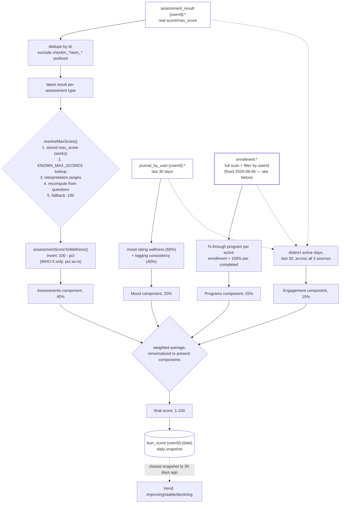

# iKan Wellness Score

Pulled live from Supabase project `jpfvoevxegnknxoqmwye` on 2026-08-06, **one bug fixed the same
day**. Answers the direct question: how is it calculated, and does it depend on the Scoring Engine
or Rule Engine?

## Short answer: it's fully independent of the Scoring Engine and Rule Engine

`ikan-score-routes.ts` (448 lines, all logic in one file) never reads `scoring-profile:` or
`recommendation_rule:`. It has its **own**, fourth, independent scoring mechanism — a hardcoded
`KNOWN_MAX_SCORES` table for named clinical instruments (`phq9`, `gad7`, `pss`, `dass21`, etc.) plus
its own percentage-inversion logic. This doesn't connect to `scoring-engine.md` or `rule-engine.md`
at all today — worth knowing before assuming a change to either would affect the wellness score.

## What it is

A composite 0-100 score blending four weighted components, computed fresh on every request (not
cached beyond a daily snapshot for trend comparison):

| Component | Base weight | Source |
|---|---|---|
| Assessments | 40% | Latest result per assessment type, inverted to "wellness" |
| Mood | 20% | Last-30-days mood journal entries: rating + logging consistency |
| Programs | 25% | Active/completed equip enrollment progress |
| Engagement | 15% | Distinct days with any activity in the last 30 |

**Weights redistribute when a component has no data** — e.g. a user with no mood entries gets their
score computed from assessments (40) + programs (25) + engagement (15) renormalized to 100%, not
penalized for the missing 20%. `hasData: false` (score `0`, not a real "you're doing badly" number)
only when *all four* are empty.

| Piece | Location |
|---|---|
| Computation | `computeIkanScore(userId)` in `ikan-score-routes.ts` |
| Endpoints | `GET /user/ikan-score` (compute + return today's), `GET /user/ikan-score/history` (trend) |
| Snapshot storage | `ikan_score:{userId}:{date}` — one per day, used only for the 30-day trend comparison |
| Auth | Both routes `requireAuth` — real user session needed to test, same caveat as the Recommendation Engine fix |

## How it works

## ✅ Fixed: enrollment fetching matched the wrong key shapes, undercounting real programs

The Programs component (25% weight) queried two prefixes:
`kv.getByPrefix('enrollment:${userId}:')` and `kv.getByPrefix('user_enrollment:${userId}:')`.
Verified against a real user with 34 real enrollments (any shape, matched by value field):

| Query | Matches |
|---|---|
| `enrollment:{userId}:` prefix scan | **0** — real keys are `enrollment:{enrollmentId}`, an opaque id, never userId-prefixed |
| `user_enrollment:{userId}:` prefix scan | **4** — a separate, narrower legacy mirror, itself permanently stale on `currentDay`/`completedDays` (the same bug already found and fixed elsewhere this session for the primary `enrollment:` shape — this mirror was never touched by that fix) |
| Real total (scan `enrollment:*`, filter by `value.userId`) | **34** |

So the Programs component was silently computing from roughly 1 in 8 of a user's real enrollments,
picking up whichever ones happened to have a `user_enrollment:` mirror written at creation time (a
write path inside `index.tsx`) and missing the rest entirely. Fixed to do a full `enrollment:`
prefix scan filtered by `value.userId`/`value.user_id`, deduplicated by equip id keeping the
most-recently-touched record — the same pattern already proven correct in
`progress-service.ts`'s `getUserEnrollments()`. Deployed; not yet confirmed via a live authenticated
request (same caveat as the Recommendation Engine fix — the endpoint requires real auth).

## 🟡 Open, not fixed: General's flat score mixes two directions before being inverted

`assessmentScoreToWellness()` assumes every assessment except WHO-5 is "higher score = more
distress" and inverts accordingly (`100 - pct`). This holds for every *standalone* assessment
(Anxiety, Depression, Stress, Sleep, Balance, Burnout — all confirmed higher-is-distress in the
assessment audit docs). It does **not** hold for General, whose flat `score` field (what this file
reads) is a raw, unweighted sum across sections with opposite directions — GAD-2/PHQ-2 items
(higher = worse) summed together with WHO-5/self-efficacy/resilience items (higher = *better*), with
no reversal applied anywhere in the flat-sum path (confirmed: no reversal logic exists in
`AssessmentFlow.tsx`'s fallback score computation). A user who is anxious *and* highly resilient
could produce a high raw sum from both halves, which this file then inverts as if a high raw sum
were uniformly bad — semantically incoherent for this one assessment specifically.

Not fixed here: a correct fix means either giving General's flat score a section-aware computation
(mirroring the frontend's `computeSectionScores()`/`SECTION_PRESETS` logic, which this backend file
has no access to today) or excluding General from the wellness-score assessment component entirely
until it does. Both are design decisions, not a one-line patch — flagging for whoever owns the
wellness score's correctness, consistent with how this session has handled other design-level gaps
(Rule Engine's global-config path, the two zero-reader Metadata Catalog types).

## Proposed: wellness score v2, using the 3 engines (sketch only — not built)

The user's own stated plan: rebuild this using Scoring Engine + Rule Engine + Recommendation Engine
together, rather than the current independent 4th mechanism. This is a **structure sketch for a
future session**, not an implementation — recorded here so the shape doesn't get re-derived from
scratch later.

**Proposed inputs** (per the user's list, mapped to what's already live):

| Input | Source today | Status |
|---|---|---|
| Program data | `enrollment:` + `progress:` (full scan, already fixed this session — §09 above) | Ready |
| Assessment score | `assessment_result:` + Scoring Engine bands (`scoring-profile:`, §06 — currently 0 profiles authored) | Data ready, scoring content not yet authored |
| Mood journal | `journal_by_user:` (Check-in Scales-driven entries, §05) | Ready |
| Health Connect / IoT data | `hc_data:`/`hc_history:` (§16 — correctly wired, 0 live rows, no user has connected yet) | Ready, unpopulated |
| User personal info | `user:` profile record | Ready (ghost-user cleanup done this session, §12) |
| Activity & frequency | `activity_log:` (584+ rows) / `activity:daily:` (§12) | Ready |

**Proposed mechanism** (sketch, not decided): rather than the current file's own hardcoded
percentage-inversion logic, route each component's severity computation through the **Scoring
Engine** (once profiles exist) for consistent banding, and route any resulting recommendations
through the **Rule Engine** + **Recommendation Engine** (already fixed this session, §08/§14) instead
of a 4th independent formula. This would also resolve the "General's mixed-direction score" bug
above by construction, if General gets a real Scoring Engine profile with section-aware bands
instead of a flat-sum fallback.

**Explicitly not started**: no code changes, no new KV prefixes, no schema. This section exists so
the next session building this has the input inventory and the direction already agreed, rather than
re-auditing what's available from zero.

## Verification notes

1. `KNOWN_MAX_SCORES`'s lookup keys (`phq9`, `gad7`, `pss`, etc.) never match this app's actual
   assessment ids (`asm_1767...`-style) — confirmed by inspection, not exercised in practice because
   step 1 of `resolveMaxScore()` (stored `max_score`) already succeeds for every real
   `assessment_result:` record. The table is real code but effectively decorative for this app's
   current id scheme — noted, not fixed, since it's harmless as long as step 1 keeps working.
2. The enrollment bug was verified against live data (0 vs. 4 vs. 34 matches for a real user) before
   being written up or fixed — not inferred from reading the code alone.
3. Mood and assessment data sources (`journal_by_user:`, `assessment_result:`) were already
   independently verified correct and complete in `mood-checkin.md` and the assessment audit docs —
   not re-verified here, just confirmed this file reads the right prefixes for both.
