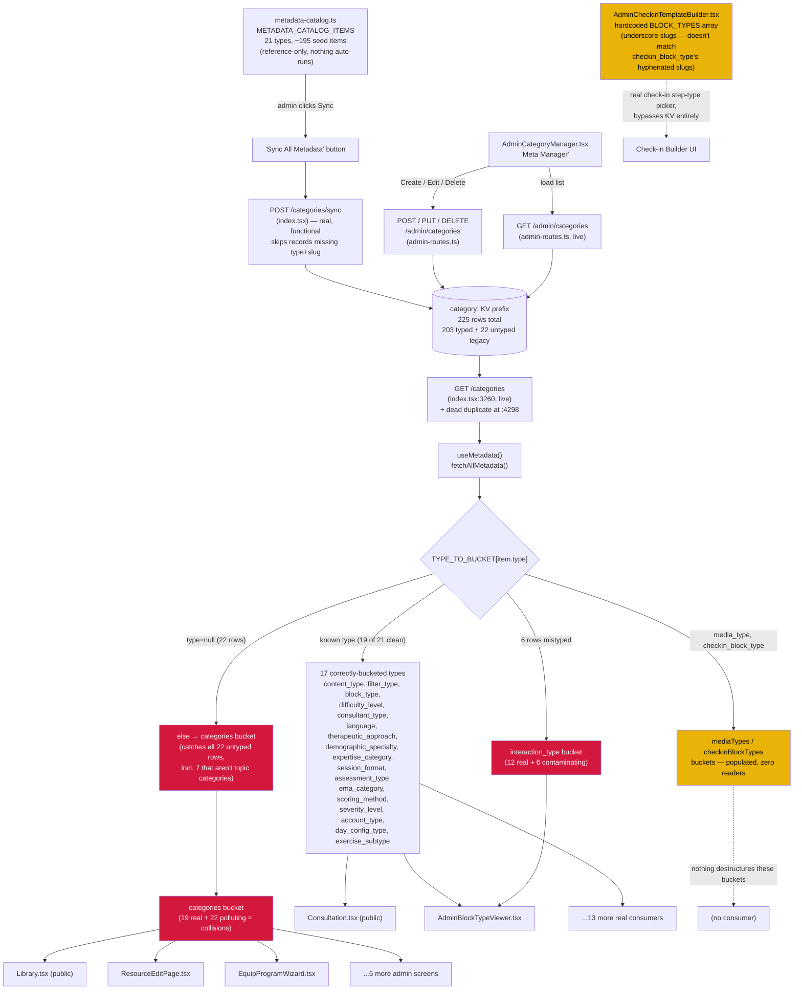

# Metadata Catalog ("Meta Manager") — all 21 types, verified end-to-end

Pulled live from Supabase project `jpfvoevxegnknxoqmwye` on 2026-08-06, **fixed the same day**.
This covers the generic admin taxonomy system: one `category:` KV prefix, one shared
`useMetadata()` React hook, one generic CRUD editor (`AdminCategoryManager.tsx`, labelled "Meta
Manager" in the sidebar) driving 21 distinct metadata types across 18 real frontend screens.

## Status

| Finding | Status |
|---|---|
| Bug 1 — 22 untyped legacy `category:` records polluting Topic Categories, non-deterministic dedup | ✅ **Fixed** — 21 pure duplicates deleted, 1 genuinely unique record (`content_type:mood`) retyped and kept |
| Bug 2 — 6 `interaction_type` records mistyped from `checkin_block_type` | ✅ **Fixed** — 6 duplicates deleted, correct originals already existed under `checkin_block_type` |
| Bug 3 — `media_type` (5/5 records, correctly synced) has zero real readers | 🟡 Open — needs a product decision (wire up a real consumer, or remove the tab), not fixed |
| Bug 4 — `checkin_block_type` (7/7 records) has zero real readers; real UI uses a hardcoded, differently-formatted array | 🟡 Open — same as Bug 3 |
| **Postscript, found while fixing**: 8 more `category:cat-mood_type-*` records, orphaned leftovers from a "Sync All" run before `mood_type` was retired (see `mood-checkin.md`) | ✅ **Fixed** — deleted, plus removed the last residual `mood_type`/`moodTypes` wiring from `useMetadata.ts` (0 consumers anywhere, confirmed by grep before removing) |

Post-fix verification: `select value->>'type', count(*) from kv_store_cc205da9 where key like
'category:%' group by 1` now returns exactly 21 types, zero nulls, correct counts —
`category`=19, `interaction_type`=12, `content_type`=8 (was 7, +1 for the retyped `mood` record).
Edge function (unaffected — this was frontend-only + direct KV fixes) and frontend both verified;
`GET /categories` confirmed clean via the live endpoint post-deploy.

The brief for this audit named 20 types; the actual `MetadataType` union in
`src/admin/catalog/metadata-catalog.ts` and the `ALL_TYPES` array in `AdminCategoryManager.tsx` both list
**21** (the 20 named plus `checkin_block_type`, which is also in the requested list — the
requester's count was just off by one). All 21 are covered below. `mood_type` is a 22nd value
still wired into `useMetadata.ts`'s bucket map but deliberately excluded from `ALL_TYPES` and from
`metadata-catalog.ts` as of today's `AdminMoodManager.tsx` retirement (see `mood-checkin.md`) — it
is out of scope here on purpose, not missed.

Every count below is a direct `select value->>'type' as type, count(*) ... group by 1` (or a
per-type follow-up query) against `kv_store_cc205da9`, not an assumption from route names, code
comments, or the seed catalog. Given the sibling mood_type finding turned on "an admin screen
writes to a prefix nothing reads," every write endpoint and every real consumer was traced by
reading the actual route handler and the actual component code, not inferred.

## Headline result

**No type has zero records** — the exact mood_type failure shape (dead admin tab, KV prefix with
0 rows, silent fallback to hardcoded data) does not recur here. All 21 types have real,
non-trivial record counts. But two different bugs of comparable severity were found instead:

1. **22 legacy `category:` records with no `type` field silently pollute the `categories` bucket**
   for every one of the ~9 real consumers of Topic Categories, including the public `Library.tsx`.
2. **`checkin_block_type` (7/7 records, correctly synced, correct write path) has zero real
   readers** — the actual check-in builder UI uses a hardcoded array instead, making the entire
   "Check-in Block Types" admin tab exactly as decorative as `AdminMoodManager.tsx` was, just
   without the write-goes-nowhere error, because nothing tries to read it either way.

## Per-type table

All 21 types use the same write path (`AdminCategoryManager.tsx` → `POST/PUT/DELETE
/admin/categories`, `admin-routes.ts`) and the same read path (`GET /categories`, `index.tsx`) —
**confirmed identical for every type**, unlike the mood_type case where write and read pointed at
different prefixes. The catalog counts below are `METADATA_CATALOG_ITEMS` entries in
`src/admin/catalog/metadata-catalog.ts`; "extra" means real records exist beyond the catalog seed.

| Type | KV records | vs. catalog seed | Real consumer(s) | Status |
|---|---:|---|---|---|
| `category` | 19 typed + **22 untyped (polluting)** | matches (19) | `Library.tsx` (public), `ResourceEditPage.tsx`, `EquipProgramWizard.tsx`, `AssessmentEditPageWizard.tsx`, `AdminEquipProgramManager.tsx`, `RecommendationRulesManager.tsx`, `AdminAssessmentManager.tsx`, `UnifiedBasicInfoForm.tsx`, `AdminResourceManager.tsx` | 🔴 polluted, see Bug 1 |
| `content_type` | 7 | matches | `AdminResourceManager.tsx` | clean |
| `filter_type` | 9 | matches | `AdminResourceManager.tsx`, `Library.tsx` (public), `ResourceEditPage.tsx` | clean |
| `interaction_type` | 18 (12 real + **6 mistyped**) | matches (12) | `AdminBlockTypeViewer.tsx` | 🔴 polluted, see Bug 2 |
| `block_type` | 7 | matches | `AdminBlockTypeViewer.tsx`, `BlockEditorPane.tsx` (was `EquipBlockEditor.tsx`) | clean |
| `difficulty_level` | 3 | matches | `UnifiedBasicInfoForm.tsx`, `ResourceEditPage.tsx`, `EquipProgramWizard.tsx`, `AssessmentEditPageWizard.tsx`, `AdminEquipProgramManager.tsx` | clean |
| `consultant_type` | 6 | matches | `AdminConsultationManager.tsx`, `ProfessionalApplication.tsx`, `ConsultantEditPage.tsx`, `Consultation.tsx` (public booking flow) | clean |
| `language` | 12 | matches | `ProfessionalApplication.tsx`, `ConsultantEditPage.tsx`, `Consultation.tsx` (public) | clean |
| `therapeutic_approach` | 13 | matches | `ProfessionalApplication.tsx`, `ConsultantEditPage.tsx` | clean |
| `demographic_specialty` | 11 | matches | `ProfessionalApplication.tsx`, `ConsultantEditPage.tsx` | clean |
| `expertise_category` | 21 | matches | `ProfessionalApplication.tsx`, `ConsultantEditPage.tsx`, `Consultation.tsx` (public) | clean |
| `session_format` | 4 | matches | `ConsultantEditPage.tsx` | clean |
| `assessment_type` | 3 | matches | `AdminAssessmentManager.tsx`, `UnifiedBasicInfoForm.tsx` | clean |
| `media_type` | 5 | matches | **none found anywhere** | 🔴 dead, see Bug 3 |
| `ema_category` | 11 | matches | `AdminCheckinTemplateBuilder.tsx` (real EMA-category picker) | clean |
| `scoring_method` | 4 | matches | `AdminScoringEngine.tsx` | clean |
| `severity_level` | 7 | matches | `RecommendationRulesManager.tsx`, `AdminScoringEngine.tsx` | clean |
| `account_type` | 6 (4 seed + 2 admin-added: `consultant`, `contributor`) | +2 legit | `AdminUserManager.tsx` | clean — extras are real admin-created entries, not a bug |
| `day_config_type` | 11 | matches | `AdminBlockTypeViewer.tsx` | clean |
| `exercise_subtype` | 11 | matches | `AdminBlockTypeViewer.tsx`, `BlockEditorPane.tsx` / `BlockFieldSections.tsx` (was `EquipBlockEditor.tsx`) | clean |
| `checkin_block_type` | 7 | matches | **none — real UI uses a hardcoded array** | 🔴 dead, see Bug 4 |

**17 of 21 types are fully clean**: correct write=read path (verified, not assumed), a real
frontend consumer confirmed by grep + read of the actual component, no duplicate slugs within the
type, no placeholder/test content. 4 types have confirmed issues, detailed below.

## How the system actually works (verified, not inferred from names)

- `useMetadata()` (`src/admin/ui/hooks/useMetadata.ts`) fetches once via `apiClient.getPublicCategories()`
  → `GET /categories` (`index.tsx` line 3260, the live handler — a second, byte-identical `GET
  /categories` at line 4298 is dead code, shadowed because Hono matches the first-registered route
  and `registerAdminRoutes`/direct `app.get` calls execute before line 4298 is ever reached).
- Every item gets bucketed by a hardcoded `TYPE_TO_BUCKET` map keyed on `item.type`. **Any record
  whose `type` doesn't match a known key — including `type: undefined`/`null` — falls through to
  `else { bucket.categories.push(mapped) }`.** This fallback is the root cause of Bug 1.
- `AdminCategoryManager.tsx` writes through `POST/PUT/DELETE /admin/categories`
  (`admin-routes.ts`), all keyed `category:{id}`, matching the read prefix exactly. There is a
  parallel, dead `GET /admin/categories` handler in `resource-routes.ts` (registered after
  `admin-routes.ts`'s, so shadowed) — same data, harmless duplicate, not a live bug.
- **`POST /categories/sync`** (`index.tsx` line 3284) is real and functional — it bulk-upserts
  `METADATA_CATALOG_ITEMS` from `metadata-catalog.ts`, keyed by `type::slug`, skipping items that
  already exist unless `updateExisting` is passed. This *is* how most of the 203 typed records got
  their exact catalog-matching counts (confirmed via `docs/CHANGELOG.md`'s Session-13 entry describing
  this exact sync run). **Initial investigation of this repo's uncommitted working-tree diff
  briefly suggested this route had been deleted — it has not; `git diff HEAD` shows the deletion
  comment refers only to the already-removed `POST/PUT/DELETE /categories` trio, and the sync
  route itself is unchanged, present, and correctly wired.** Flagging this near-miss because it's
  the exact kind of assumption this audit is supposed to guard against — verified by reading the
  live file content directly, not the diff summary.
- Critically, `POST /categories/sync`'s existing-item map only indexes records that already carry
  **both** `type` and `slug` (`if (e?.type && e?.slug)`). The 22 untyped legacy records are
  therefore invisible to sync — re-running "Sync All Metadata" will never touch, dedupe, or clean
  them up. They are permanent orphans until someone deletes them by hand.

## 🔴 Bug 1 (headline finding): 22 untyped legacy `category:` records silently pollute the Topic Categories dropdown everywhere

Evidence, in order:

1. Querying `category:` records with `value->>'type' is null` returns exactly 22 rows, all keyed
   `category:cat_<timestamp>_<random>` and all dated **2025-12-30** (months before the current
   `cat-{type}-{slug}` catalog-sync convention started, per their `created_at` values). They use a
   legacy `group` field instead of `type`: 15 have `group: "category"` (`general`, `anxiety`,
   `depression`, `stress`, `burnout`, `sleep`, `balance`, `focus`, `resilience`, `motivation`,
   `mindfulness`, `habits`, `energy`, `relationships`, `confidence`), 4 have `group:
   "content_type"` (`assessment`, `equip`, `resource`, `mood`), 3 have `group: "filter_type"`
   (`Article`, `Video`, `course`).
2. `useMetadata.ts`'s `TYPE_TO_BUCKET[item.type]` looks up on `type`, not `group`. For all 22 of
   these, `item.type` is `undefined`, so `bucketKey` is `undefined`, so **every one of them lands
   in the `categories` bucket** — including the 4 that are conceptually content types and the 3
   that are conceptually filter types. The `group` field is never consulted; it's dead metadata.
3. 15 of the 22 share an **identical slug** with a real, properly-typed `category` record (all 19
   real category slugs except `insomnia`, `wellness`, `work-life`, `mental-health`). Confirmed via
   `select ctid, key, value->>'type', value->>'slug', value->>'icon', value->>'created_at' ... order
   by ctid` on the `stress`/`anxiety`/`general` slugs: the physical row order returned by an
   unordered scan does **not** track `created_at` (e.g. `category:cat-category-stress` created
   2026-03-16 physically precedes `category:cat_..._ifaclt7eq` (the legacy 2025-12-30 duplicate) in
   one ordering, but the reverse pattern shows elsewhere) — because `kv.getByPrefix('category:')`
   (`content-service.ts` / `kv_dual_write.ts`) issues a plain Supabase `.like()` scan with **no
   `.order()` clause anywhere in the fetch chain**, and `useMetadata.ts`'s `dedup()` keeps whichever
   copy of a colliding slug happens to appear first in that unordered result and silently discards
   the other.
4. **Net effect**: the Topic Categories dropdown — consumed by `Library.tsx` (a real, public,
   user-facing screen), `ResourceEditPage.tsx`, `EquipProgramWizard.tsx`,
   `AssessmentEditPageWizard.tsx`, `AdminEquipProgramManager.tsx`, `RecommendationRulesManager.tsx`,
   `AdminAssessmentManager.tsx`, and `UnifiedBasicInfoForm.tsx` — can silently show either the
   intended colored/iconed category (`Stress` 🔥 red) or its flat grey duplicate (`stress`, generic
   file icon, `color: #2A2A2A`) for 15 of 19 categories, **with no code change and no admin action**,
   purely because Postgres physical row order isn't pinned. It can also show 7 items that don't
   belong in a topic-category list at all (`assessment`, `equip`, `resource`, `mood`, `Article`,
   `Video`, `course` — these are content-type/format values, not topics).
5. `POST /categories/sync`'s existing-item map requires both `type` and `slug` to register a match
   (see above), so these 22 records are permanently invisible to the one cleanup mechanism that
   exists. They will not go away on their own.

This is not a hypothetical: it is a live, running discrepancy in the single most-consumed metadata
type in the system, provable from the actual `useMetadata.ts` fallback branch plus the actual KV
data, exactly the standard of evidence the mood_type finding set.

## 🔴 Bug 2: `interaction_type` is cross-contaminated with 6 `checkin_block_type` records

`interaction_type` has 18 real (typed, `cat-interaction_type-*` keyed) records, but the catalog
only defines 12. The 6 extras are exact duplicates — by slug and name — of 6 of the 7
`checkin_block_type` catalog entries, just filed under the wrong `type`:

| Slug | Name | Belongs under |
|---|---|---|
| `emoji-scale` | Emoji Scale | `checkin_block_type` |
| `free-text` | Free Text | `checkin_block_type` |
| `multi-select` | Multi Select | `checkin_block_type` |
| `single-choice` | Single Choice | `checkin_block_type` |
| `slider` | Slider | `checkin_block_type` |
| `yes-no` | Yes / No | `checkin_block_type` |

All 6 are separately, correctly present under `checkin_block_type` too (that type has its full,
clean 7/7 including `context-tags`, which has no `interaction_type` duplicate — so the
contamination is 6 of 7, not all 7). `AdminBlockTypeViewer.tsx`'s `kvInteractionTypes` dropdown —
used when picking how a program block collects a response — therefore offers 18 options where only
12 (`read`, `watch`, `select-one`, `select-many`, `write`, `rate`, `check`, `track-table`,
`input-table`, `clinical`, `upload`, `complete`) are meaningful `InteractionType` values; the other
6 are check-in-flow concepts that don't apply to equip blocks. No duplicate-slug collision *within*
`interaction_type` itself was found (each of the 18 has a unique slug), so this doesn't hit the
`dedup()` nondeterminism from Bug 1 — it's a straightforward wrong-type data-entry error, most
likely a copy/paste or bulk-create mistake while the "Interaction Types" tab was active in Meta
Manager, that nothing in the generic editor validates against.

## 🔴 Bug 3 & 4: two types are fully synced and correctly wired but have zero real readers

Both are structurally the same shape as the mood_type finding — an admin tab edits real,
successfully-written KV data that the live app never reads — just without the write-goes-nowhere
error, because in these two cases nothing even tries to read the KV copy:

- **`media_type`** (5/5 records: `image`, `video`, `audio`, `document`, `pdf` — clean, matches
  catalog exactly, no placeholder content). Grepped for `mediaTypes` (the bucket key) and for the
  literal string `media_type` across every file in `src/components` — the only two hits are the
  `AdminCategoryManager.tsx` tab list itself. No component destructures `mediaTypes` from
  `useMetadata()`. `EquipBlockEditor.tsx` (since renamed and rebuilt into `src/admin/builder/editor/`; no `mediaType` variable there now) had an unrelated local variable also named `mediaType`
  used purely for file-upload-kind detection (`isVideo ? 'video' : 'image'`) — confirmed by reading
  it, and confirmed it has no connection to the KV-backed metadata type. There is no equivalent
  hardcoded fallback either; the "Media Types" tab in Meta Manager is simply pointed at nothing.
- **`checkin_block_type`** (7/7 records: `emoji-scale`, `free-text`, `multi-select`,
  `single-choice`, `slider`, `yes-no`, `context-tags` — clean, matches catalog, correctly synced).
  The real, live check-in step-type picker is `AdminCheckinTemplateBuilder.tsx`'s hardcoded
  `BLOCK_TYPES` array (lines 82–90), with **underscore-separated** values (`emoji_scale`,
  `free_text`, `multi_select`, `single_choice`, `slider`, `yes_no`) — not even the same string
  format as the KV records' **hyphenated** slugs, so even a naive lookup-by-value wouldn't line up
  without normalization. `useMetadata.ts` does expose a `checkinBlockTypes` bucket key (wired
  through `TYPE_TO_BUCKET`), but grepping for `checkinBlockTypes` across `src/components` and
  `src/hooks` turns up only its own definition inside `useMetadata.ts` — no component ever
  destructures it. Editing "Check-in Block Types" in Meta Manager today has exactly the same
  real-world effect as editing `mood_type` did before today's retirement: the write succeeds, the
  toast says "Updated successfully," and nothing downstream ever changes.

## What checked out clean

- **No type has 0 records** — every one of the 21 types has real, populated data. The specific
  mood_type failure mode (dead prefix, hardcoded-fallback masking an empty admin tab) does not
  recur anywhere in this system.
- **Write path = read path for all 21 types**, confirmed by reading the actual route handlers, not
  assumed from naming: `AdminCategoryManager.tsx` → `POST/PUT/DELETE /admin/categories`
  (`admin-routes.ts`) → `category:{id}`; `useMetadata()` → `GET /categories` (`index.tsx`) →
  `category:` prefix scan. Same prefix, both directions, every time.
- **No duplicate slugs within any single, correctly-typed metadata type.** The `select type, slug,
  count(*) ... having count(*) > 1` query returned zero rows for typed records — the only
  duplication found is the *cross*-type kind described in Bugs 1 and 2, not same-type dupes.
- **No placeholder/test content.** A search for literal "test" substrings across `name`/`slug`/
  `description` on all `category:` records returned exactly one false-positive match
  (`day_config_type` "Quiz" — matched because its own description says "...tests retention"). No
  empty required fields (`name`/`slug`) found on any typed record.
- **`resource:category` orphan check is clean** — the exact reverse of Bug 1's concern.
  `resource:` records store category as a plain string field (confirmed field name, per the
  standing gotcha in this codebase's `CLAUDE.md` about `resource → category` not being an id).
  All 9 real `resource:` records (`general` ×3, `sleep` ×3, `mental-health` ×2, `stress` ×1)
  reference a slug that has a matching real `category:`-type record. Zero orphaned references.
- **`account_type`'s 2 extra records** (`consultant`, `contributor`, UUID-keyed, created via the
  generic "Add" button rather than the catalog) are legitimate admin-authored content, not a data
  bug — this is the system working as designed (the catalog is a bootstrap seed, not an
  enforced enum).
- **`ema_category`, `scoring_method`, `severity_level`, `assessment_type`, `consultant_type`,
  `language`, `therapeutic_approach`, `demographic_specialty`, `expertise_category`,
  `session_format`, `difficulty_level`, `block_type`, `exercise_subtype`, `day_config_type`,
  `content_type`, `filter_type`** — all 16 have a real, confirmed frontend consumer, correct
  counts, and no content issues. Several (`consultant_type`, `language`, `expertise_category`,
  `filter_type`, `category`) feed real, public, user-facing screens (`Library.tsx`,
  `Consultation.tsx`), not just admin tooling.

## Metadata flow (verified paths)

## Verification notes

1. All 21 per-type counts came from one grouped query
   (`select value->>'type', count(*) from kv_store_cc205da9 where key like 'category:%' group by
   1`), cross-checked against `METADATA_CATALOG_ITEMS` counted directly from
   `src/admin/catalog/metadata-catalog.ts`, not from memory or documentation.
2. The 22 null-type rows were pulled with full record bodies (`select key, value ...`), not just
   counted — their `group`/`created_at`/`id` fields were read directly to determine they're a
   pre-catalog legacy shape, not a query artifact.
3. Real-consumer claims are grep + read, not inference from the hook's bucket names: every
   component listed in the table was opened and its `useMetadata()` destructure line confirmed
   (e.g. `ConsultantEditPage.tsx`'s multi-line destructure spans 7 fields; `AdminCheckinTemplateBuilder.tsx`'s
   real block-type picker was traced by grepping for the literal step-type strings, which is how
   the hardcoded-array-instead-of-KV pattern in Bug 4 surfaced).
4. One false lead was caught and corrected during this audit: an initial `grep '*.ts'` glob missed
   `index.tsx` entirely (wrong extension), which briefly looked like `/categories/sync` didn't
   exist anywhere — re-run against the correct file confirmed it's real, live, and unrelated to any
   of the bugs above. Documented in the "verified, not inferred" section rather than silently
   dropped, since the whole point of this audit is not trusting the first negative result.
5. `resource → category` was checked as a plain string field per the standing project convention
   documented in the repo's root `CLAUDE.md` (not assumed to be an id) — matches the instruction to
   verify field names against a live record before writing a relation check.
