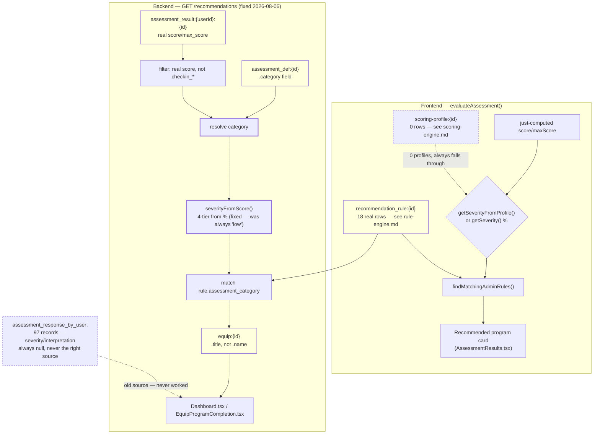

# Recommendation Engine

Pulled live from Supabase project `jpfvoevxegnknxoqmwye` on 2026-08-06, **one major bug fixed the
same day**. This is the evaluation layer — it consumes Scoring Engine profiles (`scoring-engine.md`)
and Rule Engine rules (`rule-engine.md`) and turns them into an actual recommendation. There are
**two independent implementations**, not one, and until today only one of them worked.

## The two implementations

| | Frontend | Backend |
|---|---|---|
| File | `src/lib/recommendation-engine.ts` | `src/supabase/functions/server/recommendation-service.ts` |
| Entry point | `evaluateAssessment()` | `RecommendationService.getRecommendations()`, served via `GET /recommendations` |
| Runs | Immediately after finishing an assessment, client-side | Server-side, on demand |
| Called from | `AssessmentFlow.tsx` → shown on `AssessmentResults.tsx` | `Dashboard.tsx`, `EquipProgramCompletion.tsx` |
| Input | The score/maxScore just computed for *this* completion | Every `assessment_result:` the user has ever completed |
| Status | Working (2 real bugs found and fixed this session — see below) | **Was completely broken until 2026-08-06** |

These were never meant to duplicate each other exactly — one reacts to a single just-finished
assessment, the other looks across a user's whole history for the Dashboard's "recommended for
you" section. But they both exist to answer the same question ("what program should this user try
next"), both read the same `recommendation_rule:` data, and they arrived at answers through
different, independently-buggy paths. Documented together for that reason.

## 🔴 Fixed: the backend engine returned nothing, for every user, always

`GET /recommendations` was live and correctly wired into two real screens — but
`RecommendationService.getRecommendations()` had three independent bugs stacked on top of each
other, any one of which alone would have broken it:

1. **Wrong data source.** It read `assessment_response_by_user:{userId}` — a prefix with 97 real
   records, but `severity`/`interpretation` are `null` on every single one (confirmed by direct
   query). The scores that actually exist live in `assessment_result:{userId}:{resultId}`, a
   different prefix, with real `score`/`max_score` fields.
2. **Category matching against the wrong field.** It built a `category → assessment` map keyed by
   `resp.assessment_id` (e.g. `asm_1767129926263_ru3v6dozh`), then looked rules up by
   `rule.assessment_category` (e.g. `"Anxiety"`). An assessment id is never equal to a category
   name — this lookup could not have matched, ever, for any user.
3. **`equip.name` doesn't exist.** Even in the hypothetical case both bugs above were fixed and a
   rule matched, the result was built as `equip_name: equip.name` — real equip records use `title`,
   confirmed via `shared-types.ts`'s `Equip` interface and every equip doc in `src/docs/equips/`.
   `equip_name` would have been `undefined` on every recommendation ever returned.

Between (1) and (2), the function returned `[]` for literally every user, every time, since it was
written — `normalizeSeverity()` always fell through to its hardcoded `'low'` default (both its
real branches read fields that are always null), and even a correctly-computed severity could never
find a matching rule because the category key never lined up. This is a live-and-shipped feature
(both consuming screens are real) that has never once shown a real recommendation.

**Fixed 2026-08-06:**
- Reads `assessment_result:{userId}:` instead — has real `score`/`max_score`.
- Filters out check-in responses (`assessment_id` starting with `checkin_`).
- Resolves each result's category by looking up its `assessment_def.category` field (lowercase,
  e.g. `"anxiety"`) and matching case-insensitively against `rule.assessment_category` (Title Case,
  e.g. `"Anxiety"`) — the actual category taxonomy, not the raw assessment id.
- Computes severity from the score percentage (`severityFromScore()`, 4-tier: ≤25% low, ≤50% mild,
  ≤75% moderate, >75% high) instead of trusting fields that are never populated.
- Reads `equip.title` for the recommendation's display name.
- Resolves `rule.target_id || rule.equip_id`, matching the Rule Engine's documented legacy/modern
  field fallback.

Deployed and smoke-tested (`/health` 200 post-deploy); the endpoint requires a real user JWT
(`requireAuth`), so full end-to-end verification needs a real logged-in session to confirm the
Dashboard/completion-screen recommendation cards now populate — flagging this as the one piece of
this fix not independently confirmed by direct query, unlike everything else in this session.

## Frontend engine (`evaluateAssessment`) — already audited and fixed earlier this session

- **Fixed**: hardcoded `'stress'`/`'burnout'` program-slug fallback (real slugs are
  `stress-buster`/`burnout-reset`) — see `PENDING.md`.
- **Fixed**: `loadEngineConfig()`'s false `loadedFromBackend: true` — it now only reports success
  when a rule actually has the `.severity`/`.message`/etc. fields it looks for (no real rule ever
  has), instead of inferring success from row count alone.
- **Working correctly, unaffected**: `loadAdminRules()`/`findMatchingAdminRules()` — the
  per-category equip targeting that actually drives the "Recommended program" card shown
  immediately after finishing an assessment. This is the path the 18 real rules feed successfully.
- **Also present**: `DEFAULT_RECOMMENDATION_RULES` (per-severity primary/secondary action text and
  fallback equip ids), `DEFAULT_OVERLAP_MAP` (cross-category "also consider" suggestions, e.g.
  sleep→stress), `DEFAULT_ESCALATION_RULES` (e.g. high-severity stress also recommends burnout +
  sleep). These are hardcoded defaults, used whenever `loadEngineConfig()` has nothing real to
  override them with — which, per the finding above, is always, for the global-messaging half.
  Per-category equip targeting (Rule Engine data) overrides them correctly; global severity
  bands/messaging never has, and still doesn't — that gap is a content/feature question (does an
  admin need to customize generic messaging?), not something fixed here.

## Data model

## Verification notes

1. The three-bug diagnosis was built by reading `RecommendationService.getRecommendations()`'s
   full implementation, then verifying each suspected failure point against live data — not
   inferred from the code alone. `assessment_response_by_user:` was queried directly (5 samples,
   `severity`/`interpretation` null on all 5); `assessment_result:` was queried to confirm real
   `score`/`max_score` exist there instead; `assessment_def.category` was confirmed lowercase
   against the rules' Title Case `assessment_category`.
2. Initially misread `GET /recommendations` as entirely dead code (a grep pattern missed
   `index.tsx`'s registration) — caught by testing the live endpoint directly (`401 Unauthorized`,
   not `404`, meaning the route exists) before writing that up as a finding. Corrected before it
   became a wrong claim; noted here as the same discipline applied throughout this session's audits.
3. Not independently verified: the fix's actual effect for a real logged-in user (the endpoint
   requires `requireAuth`, not just the anon key used for read-only verification elsewhere this
   session). The fix logic itself was verified against real KV data field-by-field; a live
   in-app check with a real session is the one remaining step, not performed here.
