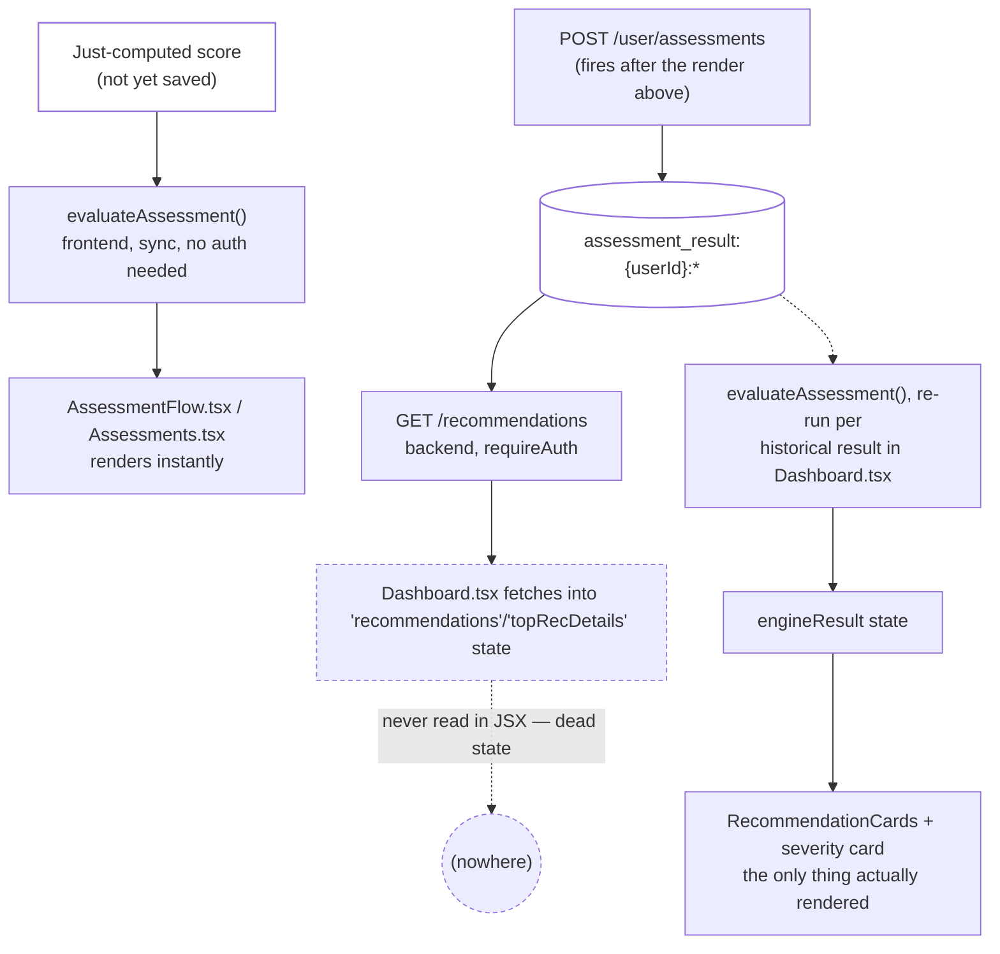

# Frontend vs. backend recommendation engines — do we still need both?

Pulled live from Supabase project `jpfvoevxegnknxoqmwye` and the repo on 2026-08-06. Direct answer
to: now that Rule Engine + Scoring Engine + Blocks exist, is `evaluateAssessment()` (the frontend
engine) still needed?

## Verdict: not redundant, but one of its two call sites is dead weight

`evaluateAssessment()` fills a gap the backend **structurally cannot** fill — but `Dashboard.tsx`
fetches the backend's answer anyway and then never renders it. Two different findings, not one:

| Question | Answer |
|---|---|
| Is `evaluateAssessment()` itself redundant? | ❌ No — it runs on an unsaved, just-computed score, before the backend has anything to read |
| Is `Dashboard.tsx`'s use of it duplicating the backend? | 🟡 Partially — see "The real overlap" below: not duplication, **dead fetched state** |

## What each one actually is

| | Frontend — `evaluateAssessment()` | Backend — `RecommendationService.getRecommendations()` |
|---|---|---|
| Location | `src/admin/engines/recommendation-engine.ts:433-571` | `src/supabase/functions/server/recommendation-service.ts:58-153` |
| Input | The score just computed in-memory, not yet saved | Every saved `assessment_result:{userId}:*` row |
| Reads | `scoring-profile:` (via `loadScoringProfiles()`, cached), `recommendation_rule:` (via `loadAdminRules()`, cached) | `assessment_result:`, `assessment_def:.category`, `recommendation_rule:`, `equip:.title` |
| Auth | None required — works pre-save, pre-auth-check | `requireAuth` — real session needed |
| Output | `EngineResult` — severity + primary/secondary actions + a written message + overlap/escalation | `{equip_id, equip_name, category, confidence, reason}` — no messaging, no secondary actions |
| Called by | `AssessmentFlow.tsx:308`, `Assessments.tsx:328` (both render immediately after finishing), `Dashboard.tsx:325,343` (historical) | `Dashboard.tsx:224` via `apiClient.getRecommendations()` |

## Why the frontend engine can't just be deleted

1. **Timing**: `AssessmentFlow.tsx` shows the result screen (line 341-342) *before* the background
   save even starts (line 348). `GET /recommendations` can only see saved rows — calling it here
   would race an unsaved record and return empty on first render, every time.
2. **Auth**: the backend route requires `requireAuth`; nothing here checks that today.
3. **Output shape**: the backend has no messaging/secondary-action/overlap/escalation fields — that
   logic would have to move server-side too, not just get swapped in.

## The real overlap, precisely — not duplication, dead fetched state

Read `Dashboard.tsx` directly (not just grepped) to get this right:

- Line 222-224: `Promise.all([...apiClient.getRecommendations()...])` fetches the backend's answer
  into `recData`.
- Line 247-251: `recData[0].equip_id` is used once, to fetch that program's details into
  `topRecDetails`.
- Line 254: `setRecommendations(recData)` stores it in state.
- Line 355: `topRecDetails`/`recData` (as `recommendations`) get written into `localStorage` cache.
- **Neither `recommendations` nor `topRecDetails` is read anywhere in the JSX/render tree** — a full
  `grep -n "topRecDetails\|recommendations\b"` across the file turns up zero usages past state
  declaration, cache read, cache write. The only thing actually rendered (`Dashboard.tsx:566-653`,
  the severity card + `RecommendationCards`) reads `engineResult` — the *frontend* engine's output,
  computed separately at lines 325 and 339-347 by re-running `evaluateAssessment()` per historical
  assessment result.

So `Dashboard.tsx` makes a real network round-trip (`GET /recommendations` + a follow-up
`getEquipProgram()` call) whose result is fetched, cached, and never shown to the user — while doing
separate, real work via `evaluateAssessment()` that *is* shown. **Not fixed here, per this turn's
scope (documentation only)** — see `docs/PENDING.md` for the precise fix.

## Hardcoded content flagged along the way (per the "no orphaned/hardcoded mapping" standard)

`evaluateAssessment()`'s severity→message/primary/secondary layer is **permanently** hardcoded, not
just "currently" — `loadEngineConfig()` (`recommendation-engine.ts:143-241`) tries to load overrides
from `recommendation_rule:` KV records, but its own inline comment (lines 161-171, written earlier
this session) confirms real records only ever carry `{assessment_category, min_severity, equip_id,
priority, rationale}` — never `.severity`/`.message`/`.severity_bands`/`.overlap_map`/
`.escalation_rules`. So `DEFAULT_RECOMMENDATION_RULES`, `DEFAULT_OVERLAP_MAP`, and
`DEFAULT_ESCALATION_RULES` (lines 52-121) are not a fallback for an empty state — they are the only
messaging content that has ever shipped, with no admin path to change it. This is the same gap
`rule-engine.md` already names ("Rule Engine's global-severity-band content gap") — restated here
because it directly explains why the "message" text on every severity card is code, not content.
**Per-category equip targeting is a separate, real path** (`loadAdminRules()`/
`findMatchingAdminRules()`, backed by the 18 real `recommendation_rule:` rows) and is unaffected by
this gap.

## Verification notes

1. `Dashboard.tsx`'s `recommendations`/`topRecDetails` dead-state finding is a direct `grep -n` for
   both identifiers across the whole file — every match cited above, no render-path usage found.
2. The hardcoded-messaging finding is confirmed by reading `loadEngineConfig()`'s own inline comment
   (`recommendation-engine.ts:161-171`), not inferred — the code already documents why the override
   path has never fired.
3. Cross-checked against `recommendation-engine.md` (the existing backend-engine doc from earlier
   this session) to avoid restating its findings with drift — the per-category targeting path and
   the backend's own severity computation are described there and not repeated in full here.
