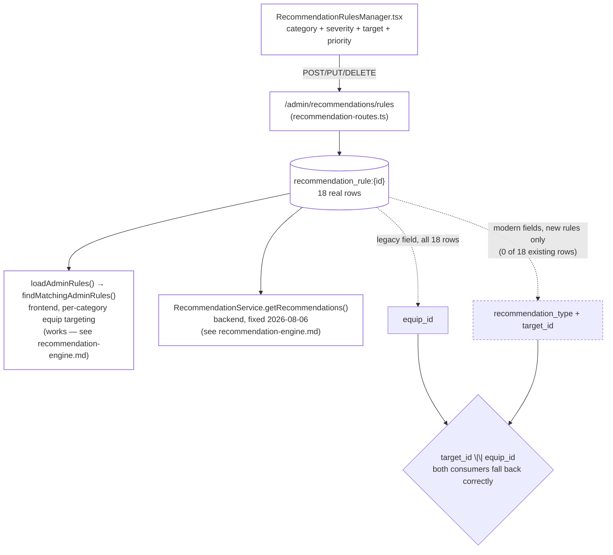

# Rule Engine

Pulled live from Supabase project `jpfvoevxegnknxoqmwye` on 2026-08-06. Kept as its own entity,
separate from the Scoring Engine (`scoring-engine.md`) and the Recommendation Engine
(`recommendation-engine.md`) — this doc covers only where admin-authored rules live and how
they're authored; the next doc covers how they get *evaluated*.

## What it is

An admin-authored table mapping **assessment category + minimum severity → a recommended target**
(an equip program, a resource, or a follow-up assessment), with a priority and a human-readable
rationale shown to the user.

| Piece | Location |
|---|---|
| Data | `recommendation_rule:{id}` in `kv_store_cc205da9` |
| Admin UI | `RecommendationRulesManager.tsx` — full CRUD, target-type picker (equip/resource/assessment), category/severity/priority/rationale |
| Backend CRUD | `POST/GET/PUT/DELETE /admin/recommendations/rules` (`recommendation-routes.ts` → `RecommendationRuleService`) |
| Consumers | `loadAdminRules()`/`findMatchingAdminRules()` in `recommendation-engine.ts` (frontend, per-category equip targeting); `RecommendationService.getRecommendations()` (backend, fixed 2026-08-06 — see `recommendation-engine.md`) |

## How it works



Every rule created *today* would write both the legacy and modern fields — the fact that all 18
existing rules only have `equip_id` is a historical-data snapshot, not a live write bug. Both
consumers resolve `target_id || equip_id` correctly either way.

## Full content — 18 real rules

| Category | Min severity | Target equip | Priority |
|---|---|---|---|
| Anxiety | mild | Stress Buster | 8 |
| Anxiety | moderate | Sleep Tight | 10 |
| Anxiety | moderate | Stress Buster | 9 |
| Anxiety | high | Unburn | 9 |
| Balance | mild | Stress Buster | 6 |
| Balance | moderate | Stress Buster | 8 |
| Burnout | mild | Stress Buster | 7 |
| Burnout | moderate | Unburn | 10 |
| Burnout | moderate | Sleep Tight | 8 |
| Burnout | high | Unburn | 10 |
| Depression | moderate | Sleep Tight | 7 |
| Depression | high | Unburn | 10 |
| General | mild | Stress Buster | 8 |
| Sleep | moderate | Stress Buster | 8 |
| Sleep | high | Unburn | 7 |
| Stress | mild | Stress Buster | 10 |
| Stress | moderate | Sleep Tight | 7 |
| Stress | high | Unburn | 10 |

Every rule targets an equip (`recommendation_type`/`target_id` are `null` on all 18 — every one
uses the legacy `equip_id` field only; see "Two coexisting rule shapes" below). Every `equip_id`
resolves to a real, currently-existing equip. **No rule targets Productivity Reset** — not a bug,
just a coverage gap: the severity-routing system currently only ever recommends Sleep Tight,
Unburn, or Stress Buster, regardless of category or severity.

## Coverage gaps (content, not bugs)

Several category/severity combinations have no rule at all:

- **General**: only `mild` is covered. A user scoring moderate/high on the General assessment gets
  no admin-authored equip recommendation at all (falls through to `recommendation-engine.ts`'s
  hardcoded slug-based fallback instead — see `recommendation-engine.md`).
- **Balance**: no `high` severity rule.
- **Sleep**: no `mild` severity rule.
- **Depression**: no `mild` severity rule.

None of these are wrong data — they're just gaps an admin hasn't filled in. Listed here so whoever
owns content authoring can see the coverage matrix at a glance rather than re-deriving it.

## Two coexisting rule shapes — schema evolution, not a bug

`RecommendationRule`'s type (`shared-types.ts`) has both a legacy `equip_id` field and the modern
generic `recommendation_type`/`target_id` pair (`recommendation_type` marked "Legacy — use
target_id instead" in the type comment, but of the two it's `equip_id` all 18 real records actually
use). `RecommendationRulesManager.tsx`'s save path writes **all three** fields for any new rule —
so this isn't a live write bug, just historical data predating the generic fields, still readable
today because every consumer falls back correctly:

```ts
// loadAdminRules() in recommendation-engine.ts
target_id: r.target_id || r.equip_id || '',
recommendation_type: r.recommendation_type || 'equip',
```

```ts
// getRecommendations() in recommendation-service.ts (backend, fixed 2026-08-06)
const equipId = rule.target_id || rule.equip_id;
```

Both consumers resolve the legacy shape correctly. If an admin creates a **resource** or
**assessment** type rule going forward (never done yet — 0 of 18 are non-equip), it will use the
modern `target_id`/`recommendation_type` fields, and both consumers already handle that shape too.

## Verification notes

1. All 18 rules' `equip_id` values checked against the live `equip:` table — every one resolves to
   Sleep Tight, Unburn, or Stress Buster (the three real equips with recommendation coverage).
2. `RecommendationRulesManager.tsx`'s save payload was read in full to confirm it writes generic
   `target_id`/`recommendation_type` fields for new rules (not just legacy `equip_id`) — the fact
   that all 18 *existing* records lack them is a historical-data fact, not evidence of a write bug.
3. See `recommendation-engine.md` for how these rules actually get evaluated, including a
   previously-fixed bug (`loadEngineConfig()`'s false-positive) and a newly-fixed one
   (`RecommendationService.getRecommendations()`, which never worked at all until today).
