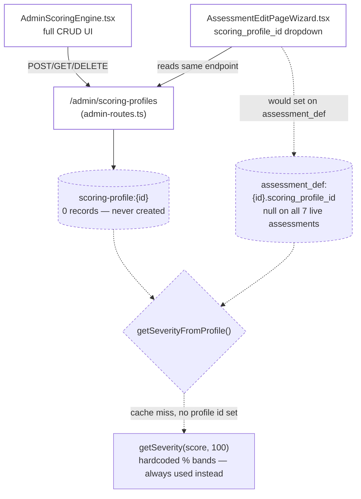

# Scoring Engine

Pulled live from Supabase project `jpfvoevxegnknxoqmwye` on 2026-08-06.

## What it is

A per-assessment override mechanism: instead of the default percentage-based severity bands
(0-30% low / 31-60% moderate / 61-100% high), an admin can define a **scoring profile** — a named
set of severity bands with a scoring method (`sum`/`average`/`weighted`/`custom`) and its own
min/max/label/color/description per band — and attach it to a specific assessment.

| Piece | Location |
|---|---|
| Data | `scoring-profile:{id}` in `kv_store_cc205da9` |
| Admin UI | `AdminScoringEngine.tsx` — full CRUD, profile name/method/`normalize_to_100`/severity bands |
| Backend CRUD | `POST/GET/DELETE /admin/scoring-profiles` (`admin-routes.ts`) |
| Assignment | `AssessmentEditPageWizard.tsx` — a `scoring_profile_id` dropdown on the assessment edit form |
| Consumption | `recommendation-engine.ts`'s `getSeverityFromProfile()`/`getSeverityBandFromProfile()`, called from `AssessmentFlow.tsx` (severity for the recommendation engine) and `AssessmentResults.tsx` (band color) whenever `assessment.scoring_profile_id` is set |

## How it works



Every solid arrow above is a real, correctly-wired connection — write and read both hit the same
`scoring-profile:` prefix, unlike the split write/read path found in the Mood Journal bug
(`mood-checkin.md`). The dashed path is what actually happens today: with 0 profiles and no
assessment assigned one, every severity calculation falls through to the hardcoded percentage
bands, every time.

## Status: correctly wired, zero data

```sql
select count(*) from kv_store_cc205da9 where key like 'scoring-profile:%';  -- 0
select value->>'title', value->>'scoring_profile_id'
from kv_store_cc205da9 where key like 'assessment_def:%';                  -- all 7: null
```

Every piece above is real and correctly connected — the CRUD writes and reads the same prefix, the
assignment dropdown reads real profiles from the same endpoint the admin screen writes to, and the
consumption code correctly falls back to percentage-based severity when no profile is set
(`getSeverityFromProfile()` → `getSeverity(score, 100)` on a cache miss). **Nobody has ever created
a profile, and no assessment has ever been assigned one.** This is not a bug — it's an unused
feature, verified end-to-end rather than assumed dead like `mood_type` turned out to be.

## Why this matters for the rest of this session's work

The per-assessment severity bands hand-written into `assessment-section-presets.ts`
(`ANXIETY_SCORING`, `DEPRESSION_SCORING`, `STRESS_SCORING`, `SLEEP_SCORING`, `BALANCE_SCORING` —
see the assessment audit docs) are exactly the kind of content a scoring profile is *supposed* to
hold. They live in code instead because this feature has never been used. Long-term, migrating
those code-side bands into real scoring profiles would make them admin-editable without a deploy —
explicitly out of scope for this session (per direction: this is reserved for building the iKan
Wellness Score later), noted here so the connection isn't lost.

## Verification notes

1. Confirmed via direct query, not assumed: 0 `scoring-profile:` records, 0 assessments with
   `scoring_profile_id` set.
2. Confirmed the write/read path matches: `admin-routes.ts`'s `POST /admin/scoring-profiles` writes
   `scoring-profile:{id}`; `GET /admin/scoring-profiles` (called by both `AdminScoringEngine.tsx`
   and `recommendation-engine.ts`'s `loadScoringProfiles()`) reads the same prefix. No split
   write/read path like the `mood_type` bug.
3. `AdminScoringEngine.tsx` pulls its `scoring_method`/`severity_level` dropdown options from the
   Metadata Catalog (`useMetadata()` — see `metadata-catalog.md`), with a hardcoded fallback if
   those come back empty. Both types are populated and clean per that audit, so the fallback never
   fires in practice.
