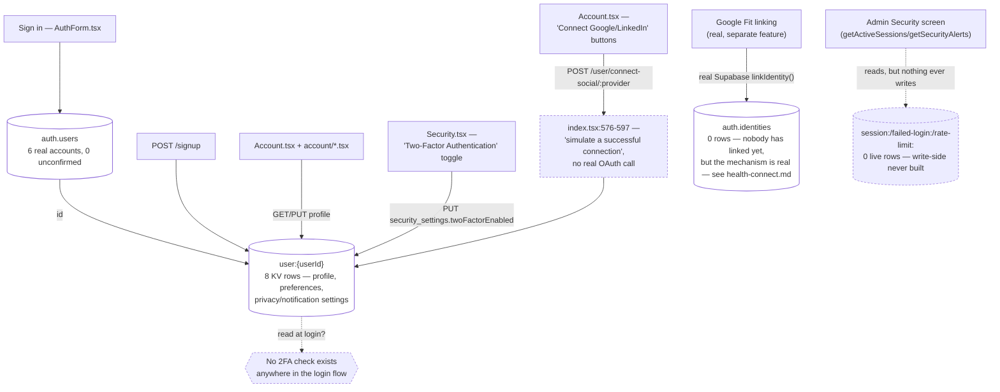
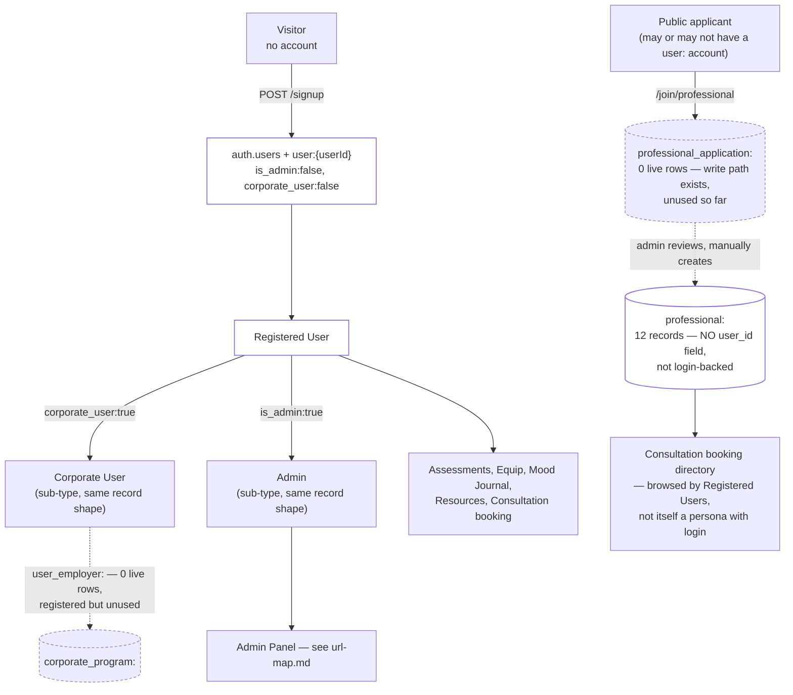

# User & Accounts

Pulled live from Supabase project `jpfvoevxegnknxoqmwye` and the repo, 2026-08-07 (§18). Direct
answer to "no KV issues, no hardcoded issues?" — **mostly clean, but two real, security-relevant
findings**: the Google/LinkedIn "Connect" buttons and the Two-Factor Authentication toggle on the
Account page are both fully decorative — neither does what it visually claims to do.

## ✅ Fixed 2026-08-07: both fake security features removed from the live UI

Per a product decision: real OAuth (needs actual Google/LinkedIn provider credentials) and real
TOTP-based 2FA (needs a verification library + login-flow UI) are genuine feature builds, not
same-session fixes — so the misleading UI was removed until real versions exist, rather than left
live giving false confidence:

- **`account/Security.tsx`**: the "Two-Factor Authentication" toggle row removed entirely (state,
  handler, and UI). `security_settings.twoFactorEnabled` may still exist on old profile records;
  nothing reads it anymore.
- **`account/Integration.tsx`**: the "Connected Accounts" card (Google/LinkedIn/Apple) removed.
  **One nuance found while removing it**: `handleSocialToggle()` actually attempted the **real**
  Supabase `linkIdentity()` flow first, and only fell back to the fake
  `POST /user/connect-social` simulation when the real call threw — meaning a real OAuth failure
  was silently masked as a fake success. This is worse than a purely decorative toggle, and is
  exactly why removing it (rather than leaving the real-attempt/fake-fallback in place) was the
  right call. **The Health Connect card on the same page is untouched** — confirmed separately
  real, no fake fallback, see §16.
- Backend routes (`POST /user/connect-social/:provider`, `/disconnect-social/:provider`) and the
  KV fields themselves were left in place, unused — no data migration needed, and real
  implementations can reuse the same profile fields later.

## Status

| Area | Status |
|---|---|
| `user:` KV schema consistency | ✅ Clean — all live-written records use the current `user_id`/`name` shape; the one exception is the already-flagged legacy ghost record (§12) |
| `user:` ↔ `auth.users` | ✅ Clean — 8 KV rows, 6 match real accounts (post-cleanup, §12); 6 real `auth.users`, 0 unconfirmed |
| `googleConnected`/`linkedinConnected` (social "connect" toggles) | ✅ **Fixed 2026-08-07** — UI removed (real-attempt/fake-fallback was masking real OAuth failures) |
| `security_settings.twoFactorEnabled` (2FA toggle) | ✅ **Fixed 2026-08-07** — UI removed (was a database flag with zero login-time enforcement) |
| `session:`/`failed-login:`/`rate-limit:` (security.tsx) | 🟡 Half-built — admin read/management functions exist and are wired in; the write-side that would ever populate these was never built (0 live rows, correctly, not a bug) |
| `professional:`/`consultant:` legacy split | 🟡 Known, pre-existing — 12 `professional:` (active) + 5 `consultant:` (legacy) records coexist |
| `user_employer:` (corporate linkage) | Registered, 0 live rows — unused feature, not a bug |

## What it is

The user profile system: Supabase Auth (`auth.users`) for credentials/session identity, plus a KV
`user:{userId}` record for everything else — profile fields, preferences, privacy/notification
settings, and (see below) two decorative security-adjacent toggles.

| Piece | Location |
|---|---|
| Backend | `index.tsx` (auth/profile routes are inline, not a separate `*-routes.ts` file), `security.tsx` (session/alert read-management), `validation.tsx` (profile validation/sanitization, password hashing) |
| Frontend | `AuthForm.tsx`/`LoginScreen.tsx` (sign-in/up), `AuthContext.tsx` (session state), `src/product/app/account/Account.tsx` + `src/components/screens/account/*.tsx` (profile editing, incl. `Security.tsx`) |
| Auth | Supabase Auth v2, email confirmation on, no OAuth identities linked today (`auth.identities` where `provider != 'email'` → 0 rows) — the real Google OAuth this app has (Google Fit linking, `linkIdentity`, see `health-connect.md`) is a **separate, legitimate** feature from the fake "Connect Google" button below |

## Live profile schema (redacted — no signed URLs/PII reproduced here)

Real accounts carry a much richer schema than the bare minimum: `bio`, `name`, `email`, `phone`,
`gender`, `zipCode`, `location`, `avatar_url` (a time-limited signed Supabase Storage URL, ~1 year
expiry), `dateOfBirth`, `corporate_user`, `is_admin`, `preferences{}` (mood reminders, weekly
reports, push/email notifications), `privacy_settings{}` (analytics, personalized content, research
participation), `security_settings{twoFactorEnabled}`, `notification_settings{}` (quiet hours,
per-category toggles), `emergencyContactName`/`Phone`/`Relationship`, `googleEmail`/
`googleConnected`/`googleConnectedAt`, `linkedinEmail`/`linkedinConnected`/`linkedinConnectedAt`.

**One legacy-shape record found** (already flagged in §12's ghost-user audit, not re-litigated
here): `user:00000000-0000-0000-0000-00000000a001` uses an older field shape (`id`/`full_name`
instead of `user_id`/`name`), created 2025-09-18 — predates the current schema. Every real,
currently-written profile (confirmed by reading every `kv.set(\`user:${...}\`, ...)` call site in
`index.tsx`) uses `user_id`/`name` consistently. Not an active schema-drift bug — one old seed
record, not a live write-path inconsistency.



## ✅ Fixed — was fake: "Connect Google" / "Connect LinkedIn" buttons did not perform real OAuth

`POST /user/connect-social/:provider` (`index.tsx:565-598`) — read the handler directly:

```
// In a real implementation, this would initiate OAuth flow
// For now, we'll simulate a successful connection
```

Clicking "Connect Google" in `Account.tsx` sets `googleConnected: true`, copies the user's own
**primary account email** into `googleEmail` (not a real Google-verified email), and stamps
`googleConnectedAt` — no Google/LinkedIn API call happens at all. `auth.identities` (Supabase's real
OAuth identity table) has 0 non-email rows, confirming nothing real is ever linked through this path.
This is visually indistinguishable from a real "connected" state in the UI — a user has no way to
tell it's not real. Not fixed here (a real feature gap needing either real OAuth wiring or removing
the buttons) — flagging as the kind of "hardcoded/fake" issue directly asked about.

## ✅ Fixed — was fake: Two-Factor Authentication toggle had zero login-time enforcement

`Security.tsx`'s 2FA toggle (`account/Security.tsx:173-176`) calls
`apiClient.updateProfile({ security_settings: { twoFactorEnabled: newVal }})` — a generic profile
field write. **Nothing in the login flow, anywhere in the repo, checks this field.** No TOTP
secret is generated, no verification-code prompt exists, `AuthForm.tsx`'s sign-in path has no
reference to `twoFactorEnabled` at all (confirmed by grep — zero hits outside the toggle's own
component and the KV field itself). The live admin account (`d5003e00-...`) currently has this set
to `true` — meaning even the person who'd most need real 2FA has a false sense that it's active.
**This is the more serious of the two fake-toggle findings** — it's a security feature, not a
cosmetic one, and the failure mode is "user believes they're protected when they aren't." Not fixed
here (needs a real TOTP implementation or the toggle removed until one exists) — flagging with
higher severity than the social-connect issue above.

## 🟡 Half-built, not broken: session/security monitoring has no write-side

`security.tsx` exports `getActiveSessions`/`terminateSession`/`getAuditLogs`/
`getSecurityAlerts`/`resolveAlert` — all imported and wired into `index.tsx`, presumably powering an
admin security-monitoring screen. But **nothing in the codebase ever writes** `session:`,
`failed-login:`, or `alert:` records — no `createSession`, no `trackFailedLogin`, no rate-limit
check-and-increment logic exists anywhere. This is why all three prefixes have 0 live rows: not a
data-loss bug, the instrumentation that would generate this data was simply never built. Consistent
with — and very likely part of the explanation for — why an admin might see a "System Health"-style
screen and judge it "useless": it's not broken, it has nothing to show because nothing populates it.

## What checked out clean

- Every real, currently-written `user:` record uses a consistent field shape (`user_id`/`name`,
  not the one legacy record's `id`/`full_name`).
- `auth.users` (6) vs `user:` KV (8, post-cleanup): the 2 extra are the already-flagged, deliberately
  -kept ghost records from §12's audit (real attached data, needs a product decision), not a new gap.
- 0 unconfirmed accounts — email confirmation is working as configured.
- Signed avatar URLs use time-limited tokens (~1 year expiry), not permanent public links — a
  reasonable pattern, not a bug (not reproduced in this doc regardless, out of caution).

## User types, personas, and ecosystem mapping

Per the user's request — identified from what the live data model actually distinguishes, not
invented. Feeds two things directly: **dashboard customization** (which persona sees what) and
**part of the wellness score input set** (§09's v2 proposal already lists "user personal info" as an
input — this is what that means concretely).

| Persona | How it's distinguished | Ecosystem touchpoints |
|---|---|---|
| **Visitor** (unauthenticated) | No `auth.users` row | Public pages, can start an assessment, gated at result-save time |
| **Registered User** | `auth.users` + `user:{userId}` profile, `is_admin:false`, `corporate_user:false` | The core persona — assessments, equip programs, mood journal, resource library, consultation booking; drives all 4 wellness-score components (§09) |
| **Corporate User** | Same as above with `corporate_user:true` | Intended to link to `corporate_program:`/`user_employer:` (both registered KV prefixes) — **`user_employer:` has 0 live rows today, this linkage is registered but unused**, not yet a real differentiated experience |
| **Admin** | Same `user:` record shape, `is_admin:true` | Full admin panel access — **not a separate account system**, just a boolean flag on the same profile shape as every other persona |
| **Professional / Consultant** | `professional:` (12 records) / legacy `consultant:` (5 records) — **confirmed via live query to have no `user_id` field at all** | Not a login-backed persona today — a directory/content entity admins manage, not a self-service account. `/join/professional` creates a `professional_application:` record (0 live rows — the review/approval write path exists in the type system but nothing has gone through it yet) for admin review, not an automatic account |



**What this means for dashboard customization**: today, the only real branch point is `is_admin`
(entirely different app — `AdminDashboard.tsx` vs. user `Dashboard.tsx`, see `url-map.md`).
`corporate_user` is registered but not yet wired to a differentiated dashboard experience — the
KV linkage (`user_employer:`) exists in the schema with 0 live rows, meaning this is a real, ready
extension point, not a gap that needs new schema.

**What this means for the wellness-score v2 proposal (§09)**: "user personal info" as an input can
concretely mean `dateOfBirth` (age-normalized banding), `gender` (if clinically relevant to specific
assessment norms), and `corporate_user` (population-level reporting scope) — all already present in
the live schema above, none requiring new fields.

## Verification notes

1. Live counts (`user:` = 8, `auth.users` = 6, `session:`/`failed-login:`/`rate-limit:` = 0 each,
   `auth.identities` non-email = 0) are direct SQL queries run this session, not estimates.
2. The "fake OAuth" and "fake 2FA" findings are based on reading the actual handler code
   (`index.tsx:565-598`, `account/Security.tsx:69-176`) — not inferred from field names alone; the
   OAuth finding is additionally confirmed by the code's own comment admitting the simulation.
3. Every `kv.set(\`user:${...}\`, ...)` call site in `index.tsx` was checked for field-shape
   consistency (`user_id` vs `id`) before concluding the legacy shape is a single historical
   record, not an active dual-write bug.
